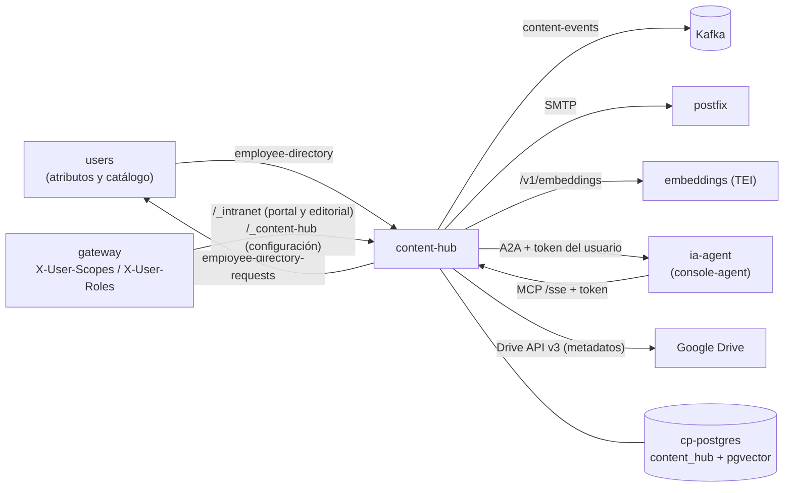
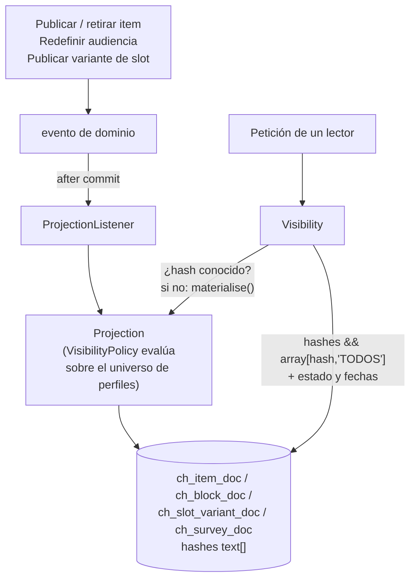
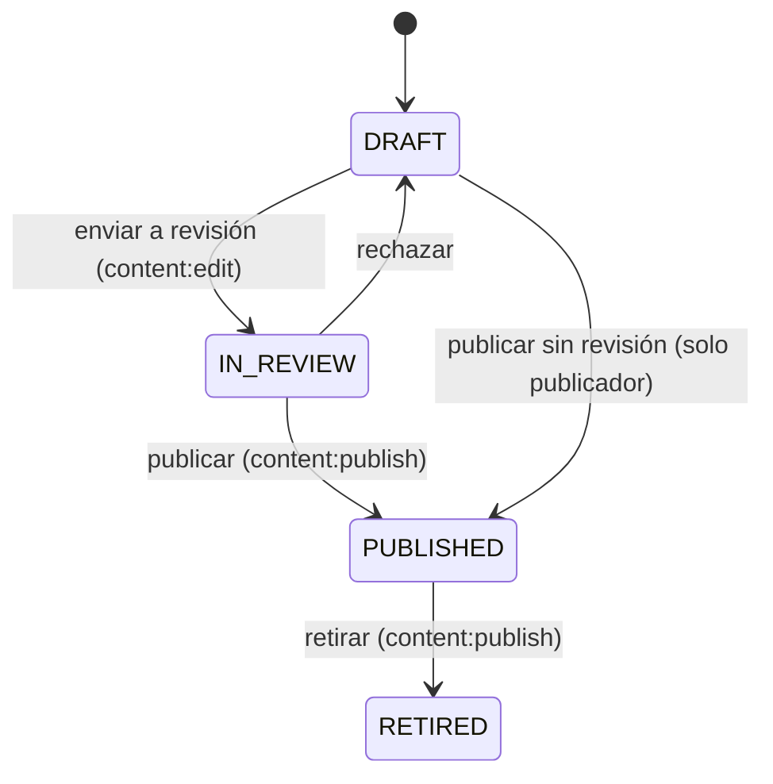
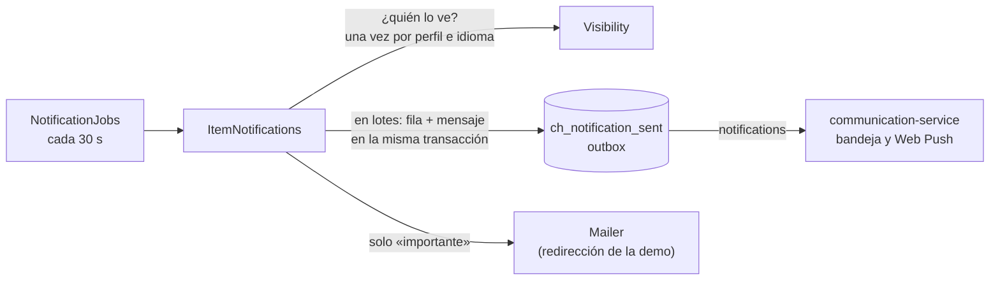

La intranet es el primer consumidor de **`content-hub`** (`supporting/content-hub`), un servicio de
contenido con **visibilidad por audiencia**: cada empleado ve solo lo que admiten sus atributos (empresa,
país, región, hotel, departamento y puesto). La spec de partida es
[`docs/specs/servicio-contenido.md`](https://github.com/miguelperezcolom/ec-demo1/blob/master/docs/specs/servicio-contenido.md);
algunos detalles cambiaron al implementarlo y esta página describe lo que hay en el código.

El principio que lo ordena todo: **todo lo que enumera contenido pasa por una única función de
visibilidad.** Páginas, bloques, menú y secciones, listados, búsqueda, favoritos, slots, newsletter, el
chat (MCP y RAG) y hasta los ficheros de la biblioteca de medios son consumidores de ella; ninguno filtra
por su cuenta.

## Componentes

Un solo servicio Spring Boot hexagonal (`domain/`, `application/`, `infra/in`, `infra/out`), puerto
**8135**, con varias puertas de entrada:

| Componente | Dónde | Qué hace |
| :--------- | :---- | :------- |
| **Portal** | `@UI("/_intranet")` (`infra/in/ui/portal`), en el shell del plano de datos (`RemoteMenu` *Intranet*) | Lo que lee el empleado: inicio, noticias, avisos, documentos, secciones, búsqueda, personas y organigrama (`People`, `PeopleListing`, `PersonPage`, `OrgChartPage`), favoritos, pendientes; comentarios y «Me gusta» en `ItemPage`, encuestas (`SurveysListing`, `SurveyPage`) |
| **Backoffice editorial** | Menú *Editorial* de la misma `@UI("/_intranet")` (`infra/in/ui/backoffice`), solo para permisos `content:*` | Contenidos, medios, contenido de slots, newsletter, encuestas y sus respuestas, moderación de comentarios, ver como y confirmaciones |
| **Portal aparte** | `@UI("/_portal")` (`PortalHome`): el mismo menú que el portal, sin *Editorial*; lo monta `consoles/intranet-shell` en `intranet.ec1.mateu.io` (Vaadin) y `rw-intranet.ec1.mateu.io` (Redwood) | La intranet para quien solo la lee, sin las consolas alrededor |
| **Configuración** | `@UI("/_content-hub")` (`ContentHubHome`), en la consola de control (`RemoteMenu` *Intranet*), `ai-admin` + `content:admin` | Secciones, audiencias con nombre, slots, UIs externas, directorio y visibilidad |
| **UIs externas** | `UiSource` (registro, `ch_ui_source`), `RemoteUis`, `RemoteUiRenderer`; `<ec-ui-source>` en `embed.js` | Pantallas de otras aplicaciones como páginas (`REMOTE_PAGE`) y bloques (`REMOTE`) de la intranet (ver [UIs externas](#uis-externas)) |
| **Servidor MCP** | `/sse` (`infra/in/mcp`), solo dentro del clúster | Las herramientas del chat, con el token de quien chatea: contenido (`preguntar_intranet`, `buscar_contenido`, `leer_item`, `confirmaciones_pendientes`) y directorio (`buscar_personas`, `ficha_persona`) |
| **Remoto de slots** | `GET /_intranet/api/slots/{key}` (`SlotController`) | La variante visible de un slot, como JSON (provisional). La consumen el inicio del data plane (`data-plane.inicio.novedades`), el del control plane (`control-plane.inicio.avisos`) y la bienvenida del front office (`front-office.bienvenida.destacado`), en servidor con el token del usuario (`ui-commons` `ContentSlots`) |
| **Medios** | `GET /_intranet/media/{id}` (`MediaController`) | Los ficheros de la biblioteca, con URL firmada |
| **Seguimiento de la newsletter** | `GET /_intranet/n/o/…` (píxel) y `/_intranet/n/c/…` (clic, redirige al item) (`NewsletterTrackingController`) | Aperturas y clics por edición y grupo, con firma HMAC (`NewsletterLinksSigner`); el gateway los deja pasar sin token |
| **`embed.js`** | `GET /_intranet/embed.js` | Convierte los marcadores de vídeo y PDF en reproductores (ver [Seguridad](#seguridad)) |
| **Solicitudes** | `RequestService`; portal `NewRequestPage`, `MyRequestsListing`, `ApprovalsListing`/`ApprovalPage` | Las solicitudes de los empleados las decide el proceso `solicitud-empleado` de EventConductor (ec-definitions). El content-hub lo arranca por su outbox (`process-creation-requested` en `upstream`, clave `solicitud:<id>`). Sigue su estado en el topic `solicitudes` (`RequestEventsListener`). Aprobar o rechazar completa la tarea del motor de formularios por REST con el token del propio usuario (`FormsHumanTasks`), que el motor acepta (`WORKFLOW_SECURITY_TRUST_FORWARDED_TOKEN`) |
| **Directorio** | `EmployeeDirectoryListener` | Copia local de los empleados —atributos, responsable (`managerId`), teléfono y etiquetas de los códigos— desde `employee-directory`. De ella salen las audiencias, la newsletter y el directorio de personas |
| **Búsqueda** | `IntranetSearch`; portal `SearchPage` | Híbrida (palabras y significado), con la respuesta de la IA y el grupo de personas (ver [Búsqueda](#búsqueda-híbrida-y-respuesta-de-la-ia)) |
| **Google Drive** | `DriveDocuments`; portal `DriveFilesListing`, `ItemPage` | Referencias a ficheros, nunca copias, y sus metadatos (ver [Google Drive](#google-drive)) |
| **Trabajos** | `ContentJobs`, `NotificationJobs` | Cruces de fechas, newsletter, embeddings del RAG, metadatos de Drive y limpieza de perfiles huérfanos; reparto de notificaciones, recordatorios y agregados diarios de uso |

Portal y trabajo editorial son la misma UI, en `ec1.mateu.io`, donde trabajan los empleados y los
editores; **la configuración** —cómo funciona la intranet, no lo que publica— va en la consola de control,
`console.ec1.mateu.io`, como el catálogo de atributos de *Usuarios*. **Los permisos separan leer de
escribir**: las pantallas llevan `@EyesOnly` (anotaciones `@Editors`, `@Publishers` y `@ContentAdmins`), y
Mateu oculta la entrada y rechaza la ruta, o el tipo enviado por el cliente, a quien no los tiene. Los
slots están partidos: el hueco es configuración (`SlotsCrud`) y sus variantes, trabajo editorial
(`SlotContentCrud`, `content:publish` porque se ven en cuanto se guardan). La identidad se la da `EditorialIdentity`, un `PrincipalResolver` que
traduce a permisos de Mateu los `content:*` de `X-User-Scopes`.



### El editor visual

Editar una página sobre la propia página (Editorial → Editor visual, `/editorial/visual/{id}`, o
«Editar sobre la página» en su formulario):

- **Alojamiento**: `VisualEditorPage` es una pantalla de Mateu con un único `Element`
  `<ec-visual-editor page-id="…" api="/_intranet/api/editor">`: la vía de escape de Mateu para un web
  component, que dibujan igual los dos renderers (Vaadin y Redwood).
- **Código**: `static/visual-editor.js`, JS sin framework, en su propio shadow root; toma los colores del
  shell (claro u oscuro). No es público en el gateway: `embed.js` (que cargan los shells y que el
  `Element` nombra como `import`) ve la etiqueta y lo pide a `GET /_intranet/api/editor/visual-editor.js`
  con el token del usuario (el que la página de arranque guarda en `localStorage`), solo para editores.
- **API** (`VisualEditorController`, bajo `/_intranet/**`, así que el gateway exige sesión y añade
  `X-User-Scopes`; no se enruta en el host de la intranet):

| Método y ruta | Qué hace | Permiso |
| :--- | :--- | :--- |
| `GET /_intranet/api/editor/pages/{id}` | Bloques del borrador, el HTML de cada uno, audiencia de la página y cuántos la ven, catálogos (tipos y sus campos, items, secciones, medios, departamentos/hoteles/puestos), perfiles para «ver como» | editorial |
| `POST /_intranet/api/editor/pages/{id}/preview` | Dibuja bloques sin guardar, como el editor o como un perfil (`viewAs`): HTML, visible o no, y cuántos empleados lo ven | editorial |
| `PUT /_intranet/api/editor/pages/{id}/blocks` | Guarda los bloques en el borrador (`ItemCommands.editBlocks`); `updatedAt` evita pisar cambios ajenos (409) | `content:edit` |
| `GET /_intranet/api/editor/media/{id}` | Un medio dibujado, para insertarlo en un texto | editorial |
| `GET /_intranet/api/editor/visual-editor.js` | El código del componente | editorial |

- **Dibujo**: `PageRenderer.draftHtml` pinta un bloque del borrador con las mismas fuentes que el portal
  (la función de visibilidad para listados y destacado) como HTML, con los medios firmados para el
  editor (`MediaUrls.EDITOR`): un borrador puede llevar medios que ningún lector puede pedir aún.
- **Guardar** pasa por `BlockForm.toBlock` (la conversión del formulario) y `ItemCommands.editBlocks`
  (el mismo saneado). La audiencia de un bloque llega solo como departamentos/hoteles/puestos, con
  valores del directorio, y `Block.isNarrowing` rechaza cualquier otra cosa (un OR, una audiencia con
  nombre): un bloque **estrecha** la audiencia de su página, nunca la ensancha (además, la efectiva es
  siempre página **y** bloque).

## La visibilidad

### El perfil y su hash

Un **perfil** son los atributos de visibilidad de un empleado, normalizados (recortados, en mayúsculas,
vacío = ausente, en el orden de los atributos). Su **hash** (`h` + 16 hex de SHA-256 de
`COMPANY=…;HOTEL=…`) nombra a todos los que ven exactamente lo mismo. **El idioma no entra**: elige la
traducción, no lo visible. Con ~30 empleados la demo tiene unas decenas de perfiles; a escala real se
estiman 2.000–5.000.

El hash es la clave de todo: de la proyección, de las cachés (dos empleados con los mismos atributos
comparten entradas) y de los grupos de la newsletter.

### La política y la proyección



- **`VisibilityPolicy`** (dominio, sin estado) es lo **único** que evalúa expresiones de audiencia.
- **`Projection`** mantiene la proyección **sujeto → hashes que lo ven**: cada traducción publicada de un
  item, cada bloque y cada variante de slot lleva una columna `hashes text[]` con índice GIN. Una
  audiencia que no restringe nada se guarda como el token `TODOS`, para que un perfil que aparezca mañana
  la vea sin recalcular.
- **`Visibility`** es la función que llaman todos los consumidores. Nunca evalúa una expresión ni filtra
  en memoria: se asegura de que el perfil del lector está en la proyección y deja que PostgreSQL filtre
  con `hashes && array[:hash, 'TODOS']`, `status = 'PUBLISHED'`, `publish_at <= now` y
  (`expire_at` vacía o futura), **en la misma consulta** que pagina, cuenta, ordena o busca.

Reglas que salen de ahí:

- **Estado y tiempo en la consulta.** Programado y caducado no son estados ni se materializan: un item
  con fecha futura aparece a su hora sin que nadie haga nada.
- **Herencia restrictiva calculada.** La audiencia efectiva de un bloque es `página AND bloque`; se calcula
  al proyectar, no se guarda, así que se cumple aunque se redefina una audiencia con nombre.
- **Hash desconocido.** Si llega un lector con un perfil aún no materializado (alta reciente, evento del
  directorio en camino, "ver como"), antes de responder se materializa **ese** hash de forma síncrona: un
  hash contra todos los sujetos son milisegundos.
- **Usuario fuera del directorio**: se le trata sin atributos y solo ve lo que es para `TODOS`.
- **Perfiles huérfanos.** Cada hora (`content-hub.jobs.orphans`, `PT1H`) se borran de la proyección y de
  la caché los hashes que ya no tiene ningún empleado activo.
- **Consistencia eventual.** Publicar o redefinir se aplica en un hilo aparte tras el commit
  (`PROJECTION_ASYNC=true`): unos segundos. El formulario del item lo dice en *Aplicado a los lectores*.
- **Caché por hash** (Caffeine, 20.000 entradas, 10 min de red de seguridad): inicio, menú y listados. La
  invalidan los mismos eventos que recalculan la proyección y los cruces de fechas.
- **Una audiencia con nombre borrada no admite a nadie**, y una que se refiere a sí misma tampoco: el
  contenido nunca se abre por accidente.

Los medios siguen la misma regla: un fichero se sirve solo a quien ve un item publicado que lo usa
(`ch_item_media`, cruzado con la proyección).

Las **encuestas** son un sujeto más de la proyección (`ch_survey_doc`): `Visibility.openSurveys` filtra por hash,
estado y fechas en la consulta, y el recálculo y la materialización de un hash nuevo las cubren como a cualquier
sujeto. Se reproyectan al publicarlas, cambiarlas o cerrarlas (`SurveyProjection`), en línea tras el commit. Los
**comentarios y «Me gusta»** no son sujetos: comentar, reaccionar o leerlos pregunta antes a `Visibility.isVisible`
por el item (`Collaboration`), y un contenido retirado o caducado deja de admitirlos.

### Las audiencias

Una audiencia es un árbol `AND`/`OR` cuyas hojas son `atributo IN (valores)`, o una **audiencia con
nombre** por referencia (nunca copiada: redefinirla cambia todo lo que la nombra). Vacía = todos los
empleados. Los atributos son una lista cerrada: `company`, `country`, `region`, `hotel`, `department`,
`jobTitle`; los valores son los códigos del catálogo del servicio de usuarios.

## Modelo de dominio

Trece agregados, referenciados entre sí solo por id, y un servicio de dominio (`VisibilityPolicy`).

| Agregado | Contenido | Invariantes |
| :------- | :-------- | :---------- |
| **Item** (`domain/item`) | Tipo (`ARTICLE`, `PAGE`, `NOTICE`, `LINK`, `DOCUMENT`), borrador (`ItemContent`: sección, audiencia, traducciones, bloques, fechas, flags, URL), versiones inmutables | Transiciones del workflow; título en el idioma por defecto; caducidad posterior a la publicación; enlaces y documentos con URL; solo las páginas tienen bloques; ids de bloque únicos |
| **Navegación** (`domain/navigation`) | El árbol entero de secciones, con orden y nombres por idioma | Sin ciclos, orden único entre hermanas |
| **Menú de un sitio** (`domain/menu/SiteMenu`) | El menú entero de un sitio (`intranet`, o una newsletter): árbol ordenado de entradas —enlaces con destino o submenús—, textos por idioma, audiencia y activa | Cuelga de la raíz o de un submenú del mismo menú, sin ciclos, orden único entre hermanas, texto en el idioma por defecto; un submenú con entradas no recibe destino |
| **Slot** (`domain/slot`) | Clave `aplicacion.pantalla.nombre`, descripción, fallback, variantes con audiencia y prioridad | Clave inmutable, prioridad única, huérfano en vez de borrado |
| **Audiencia con nombre** (`domain/audience`) | Nombre y expresión | No se refiere a sí misma |
| **Sitio** (`domain/site`) | Id, tipo (intranet o newsletter), identidad, audiencia, idiomas | La intranet es el sitio por defecto |
| **Newsletter** (`domain/newsletter`) | Maqueta, fuentes de cada sección, periodicidad, envío sin revisión, numeración, último slot | Un slot abre un solo número |
| **Número de newsletter** (`domain/newsletter`) | Número, fecha, asunto, bloques, items por sección, estado, envío por grupo | No se modifica enviado o cancelado |
| **Empleado** (`domain/employee`) | Atributos y hash; responsable, teléfono y etiquetas de los códigos (para el directorio) | Solo lo escribe el consumidor del directorio |
| **Favoritos** (`domain/favorites`) | Uno por empleado, items por id | Sin duplicados |
| **Acuse** (`domain/ack`) | (item, versión, empleado, tipo `READ`/`CONFIRMATION`) | Idempotente |
| **Conversación** (`domain/collaboration/Discussion`) | Los comentarios de un item y si está cerrado a comentarios | Texto no vacío, hasta 2.000 caracteres; cerrada no admite más; un comentario no se borra: se oculta, con quién y cuándo |
| **Me gusta** (`domain/collaboration/Likes`) | Quién ha dado «Me gusta» a un item | Uno por lector |
| **Encuesta** (`domain/survey/Survey`) | Título, descripción, audiencia, fechas, anónima o no, preguntas (`DRAFT → PUBLISHED → CLOSED`) | Publicar exige preguntas y cierre futuro; publicada, no cambia preguntas ni anonimato; las respuestas se comprueban aquí (abierta, obligatorias, opciones válidas, valoración de 1 a 5) |
| **Respuesta** (`domain/survey/SurveyResponse`) | Las respuestas de un lector; en una anónima, sin quién y con el día en lugar del instante | Solo se construye si la encuesta la acepta |

### El workflow de un item



- El editor trabaja siempre sobre el **borrador**. Publicar lo congela en una **versión** nueva; editar un
  item publicado solo toca el borrador, que vuelve a pasar por revisión por su cuenta (*cambios en
  revisión*) sin afectar a lo que se ve.
- **Programado y caducado se derivan de las fechas**, no son estados.
- **Confirmación obligatoria**: `confirmationVersion` es la versión desde la que cuentan las
  confirmaciones. Al publicar una versión nueva, «exigir reconfirmar» la mueve a la nueva; si no, las
  confirmaciones anteriores siguen valiendo.
- Los items **no se borran**: se retiran.

### Permisos editoriales

| Scope | Rol de ejemplo | Qué permite |
| :---- | :------------- | :---------- |
| `content:edit` | Editor de contenido (`content-editor`) | Crear y editar, enviar a revisión |
| `content:publish` | Publicador (`content-publisher`, con `content:edit`) | Aprobar, publicar (con o sin revisión), rechazar, retirar |
| `content:admin` | Administrador (`content-admin`, los tres) | Secciones, audiencias con nombre, slots, newsletter, recalcular la proyección. Implica los otros dos |

Son permisos y roles del servicio de usuarios. `content-hub` los lee de la cabecera **`X-User-Scopes`**
que pone el gateway; sin esa cabecera (el gateway no pudo preguntar), un usuario con el rol de realm
`admin` conserva todos, para que el usuario `demo` nunca se quede fuera.

## Eventos y topics

| Topic | Sentido | Qué lleva |
| :---- | :------ | :-------- |
| `employee-directory` | users → content-hub | `EmployeeUpserted` (el empleado entero: nombre, email, activo, `managerId` y `phone` si los tiene, atributos como códigos del catálogo e idioma, `labels` con la etiqueta de cada código) y `EmployeeRemoved`; clave el id de usuario |
| `employee-directory-requests` | content-hub → users | `{"requestId", "requestedBy"}`: pide una copia completa del directorio. Se manda al arrancar con el directorio vacío, o a mano desde *Visibilidad* |
| `content-events` | content-hub → quien quiera | Los eventos de dominio: `ItemPublished`, `ItemRetired`, `ItemBecameEffective`, `ItemExpired`, `AudienceRedefined`, `SlotVariantPublished`, `NavigationChanged`, `EmployeeChanged`, y los de colaboración (`CollaborationEvents`): `CommentPosted`, `CommentModerated`, `ItemLiked`, `SurveyPublished`, `SurveyUpdated`, `SurveyClosed`, `SurveyAnswered` (este nunca dice quién). Clave el sujeto. Hoy nadie los consume fuera del servicio |
| `notifications` | content-hub → communication-service | `NotificationRequested` con `addressees` (un lector), tipo `INTRANET_PUBLISHED` o `INTRANET_CONFIRMATION_DUE`. Ver [Notificaciones](#notificaciones) |
| `notification-resolutions` | content-hub → communication-service | `NotificationResolved`: lo que cierra esas notificaciones en la bandeja |

Todo sale por el **outbox** de `supporting/messaging`, en la misma transacción que el cambio, y
`employee-directory` entra por el **inbox** (cada mensaje una vez, por su `eventId`). En el servicio de
usuarios el outbox ya entregaba a Keycloak; un `RoutingOutboxTransport` elige por destino (`identity` a
Keycloak, `employee-directory` a Kafka) y la clave del directorio va aparte, para que una caída de
Keycloak no lo retenga.

Dentro del servicio, los mismos eventos van a `ProjectionListener` tras el commit: publicar o retirar
reproyecta el item, redefinir una audiencia recalcula toda la proyección, una variante de slot reproyecta
el slot, y los cruces de fechas y la navegación vacían la caché.

## Almacenamiento

Base de datos **`content_hub`** en **`cp-postgres`** (la instancia con pgvector), creada por el
initContainer del manifiesto. Las tablas las crea `schema.sql` al arrancar, solo con `if not exists`
(aditivo: nada se borra ni renombra); las de outbox e inbox son de la librería de mensajería.

| Tablas | Qué guardan |
| :----- | :---------- |
| `ch_item`, `ch_navigation`, `ch_slot`, `ch_named_audience`, `ch_newsletter`, `ch_favorites` | Los agregados, como documento JSON (más las columnas por las que se lista) |
| `ch_menu` | El menú de cada sitio, un documento JSON por `site_id` |
| `ch_ack` | Acuses de lectura y confirmación |
| `ch_media` | La biblioteca de medios; los ficheros subidos, en `bytea` |
| `ch_employee`, `ch_profile` | El directorio y el universo de perfiles (hash → atributos) |
| `ch_item_doc`, `ch_block_doc`, `ch_slot_variant_doc` | **La proyección**: cada traducción publicada, bloque y variante con sus `hashes text[]` (GIN) |
| `ch_item_media`, `ch_projection_state` | Qué medios usa cada item; qué versión está ya aplicada |
| `ch_chunk` | Los pasajes del RAG con su `vector(384)` |
| `ch_discussion`, `ch_likes` | Comentarios y «Me gusta», un documento por item, aparte de él |
| `ch_survey`, `ch_survey_doc` | Las encuestas, y su proyección con los `hashes text[]` que las ven |
| `ch_survey_participation`, `ch_survey_response` | Quién ha respondido y qué se ha respondido, en dos tablas que no se apuntan entre sí |
| `ch_notification_job`, `ch_notification_sent`, `ch_notification_pref` | Los repartos pendientes, qué se ha dicho a quién (item, versión, lector, tipo, canal) y cómo quiere cada uno que se le avise |
| `ch_usage_event`, `ch_usage_daily`, `ch_item_reader` | El uso: eventos en crudo (con retención), sus agregados por día y las vistas por item y lector |
| `ch_drive_file` | Lo último que Drive dijo de cada fichero referenciado (documento JSON): metadatos, nunca el fichero |

La **búsqueda de texto** es el FTS de PostgreSQL: `ch_item_doc.tsv` (configuración `simple`, índice GIN),
consulta por **prefijo** («vacac» encuentra «vacaciones»), filtrada por visibilidad en la misma consulta:
páginas y contadores solo cuentan lo visible.

## Seguridad

- **El gateway es la frontera.** `/_intranet/**` exige token en los hosts de datos; `/_content-hub/**`,
  rol `ai-admin` en los de control. Dentro, el backoffice exige un permiso `content:*` (`@EyesOnly`, ver arriba), y cada caso de uso de escritura
  vuelve a comprobar el suyo. El servicio no vuelve a verificar el token de esas rutas: lee sus
  claims (`preferred_username` es el `UserId` del servicio de usuarios) y solo es alcanzable a través del
  gateway.
- **Cabeceras `X-User-Roles` y `X-User-Scopes`.** El gateway (`UserAuthorityEnrichmentFilter`) pregunta a
  `AuthService.GetAuthInfo` del servicio de usuarios por gRPC (`AUTH_GRPC_ADDRESS`, `users:9191`) y las
  añade, separadas por espacios, cacheadas 5 minutos por token. **Siempre borra primero** las que mande
  el cliente. Es de mejor esfuerzo: si `users` no contesta, la petición sigue sin ellas. El token no se
  re-firma, porque los shells y el front office lo verifican contra Keycloak.
- **Los atributos no viajan en el token**: van por el directorio, porque la newsletter, el "ver como" y el
  universo de hashes los necesitan sin que haya petición del usuario.
- **URLs firmadas para los medios.** Un `` o un `<video>` no lleva el token, así que el gateway deja
  pasar sin autenticar `GET /_intranet/media/**` y `/_intranet/embed.js`. Cada URL la firma el servicio al dibujar la página: HMAC-SHA256 de
  `id|hash|caducidad`, válida **2 horas**, con la clave `MEDIA_SECRET`. Al servirla se comprueba la firma
  **y otra vez la visibilidad** (el item pudo retirarse). Las vistas previas del backoffice firman con
  `EDITOR`, que ve toda la biblioteca.
- **Iframes.** El saneador de Mateu (DOMPurify) quita los `<iframe>`, así que un vídeo externo o un PDF se
  dibuja como un marcador `<div data-ec-embed="URL" data-ec-embed-kind="video|pdf">` con un enlace (y la
  miniatura de YouTube). `embed.js`, que los shells cargan con `@Script` como `push.js`, lo cambia por el
  reproductor **solo** para `www.youtube-nocookie.com`, `player.vimeo.com`, `drive.google.com` y los
  medios propios firmados; cualquier otra cosa se queda en enlace. Del código de inserción que pega un
  editor solo se guardan el proveedor y el id: el reproductor se construye desde ellos, nunca desde lo
  pegado.
- **El HTML de los cuerpos se sanea** al guardarlo (`HtmlSanitizer`).
- **Anonimato de las encuestas.** Para no admitir dos respuestas, una encuesta anónima guarda en
  `ch_survey_participation` un HMAC-SHA256 de encuesta y usuario (`ParticipationKey`), con la clave
  `SURVEY_SECRET` (por defecto, `MEDIA_SECRET`) y la sal propia de la encuesta: la base de datos sola no dice quién
  respondió. `ch_survey_response` no lleva ni esa clave, ni el usuario, ni la hora (solo el día), y `SurveyAnswered`
  no dice quién. Los textos libres y la exportación van ordenados por su contenido, no por llegada. Cambiar la clave
  permitiría responder otra vez a las encuestas abiertas. Quien tenga la clave y la base podría comprobar si alguien
  concreto respondió, pero no qué respondió.
- **MCP.** El servidor MCP no pasa por el gateway (es interno del clúster): aquí sí se verifica el token
  que reenvía `ia-agent` contra Keycloak (`KEYCLOAK_JWKS_URI`, `KEYCLOAK_ISSUER_URI`) y una llamada sin él
  se rechaza. Cada herramienta lee como el usuario real (nunca como su "ver como").

## RAG y chat

- Cada traducción publicada se corta en **pasajes de ~700 caracteres** (`ch_chunk`). Un trabajo cada 15 s
  los manda en lotes de 32 al servicio **`embeddings`** del clúster (Text Embeddings Inference con
  `intfloat/multilingual-e5-small`, 384 dimensiones, prefijos `passage:` y `query:`) y guarda el vector en
  pgvector. Un item es visible antes de que sus pasajes estén embebidos; solo tarda unos segundos en
  encontrarlo el chat.
- La pregunta se embebe y se buscan los pasajes más cercanos (`<=>`) **unidos a `ch_item_doc` con el mismo
  filtro de visibilidad**: el agente nunca recibe un pasaje que la persona no pueda leer.
- Herramientas MCP (`IntranetMcpTools`):

| Herramienta | Qué devuelve |
| :---------- | :----------- |
| `preguntar_intranet(pregunta)` | Los 6 pasajes más relevantes, con su item y enlace (RAG) |
| `buscar_contenido(texto)` | Hasta 10 items por texto (prefijo); vacío, los últimos |
| `leer_item(id)` | El texto completo de un item, si lo puede ver, y si debe confirmarlo |
| `confirmaciones_pendientes()` | Lo que debe confirmar y aún no ha confirmado. Confirmar se hace en el portal, no desde el chat |

El servidor se registra en el plano de control de IA como el MCP **`intranet`**
(`gitops/example/ia/mcp/intranet.yaml`, SSE a `http://content-hub:8135`) y lo usa `console-agent`.

## Búsqueda híbrida y respuesta de la IA

`IntranetSearch` lanza dos búsquedas y las mezcla. Las dos pasan por `Visibility`, con el filtro dentro de la
misma consulta:

- **Por palabras**: el FTS de `ch_item_doc`, como siempre.
- **Por significado**: la consulta se embebe y se buscan los pasajes más cercanos de `ch_chunk`, descartando
  los que pasan de `content-hub.search.max-distance`.

`HybridRanking` las une por **fusión de rangos recíprocos** (`Σ 1 / (60 + rango)`): rangos y no puntuaciones,
porque `ts_rank` y la distancia coseno no están en la misma escala. Lo que aparece en las dos listas sube. Un item
encontrado solo por significado se vuelve a pedir a `Visibility`. El subtítulo de cada resultado es el pasaje
que coincidió, recortado alrededor de la palabra (`Snippets`). Sin el servicio de embeddings se busca solo por
palabras (un timeout de 10 s para las preguntas, que tienen a alguien esperando) y la página lo dice.

`SearchPage` es un `Form` con el template `MultimediaContentPage` y no un listado, porque respuesta, resultados
y personas dependen de la misma consulta (`HeroSearchPage` trae en Redwood su propia caja, atada a un listado). No pagina: los 20 mejores.

**Mateu llama a `component()` más de una vez por petición** (para localizar el botón de la acción y para
dibujar), así que la página guarda lo calculado por consulta en un campo `final`: sin eso cada búsqueda llamaba
dos veces al agente, a cuenta del presupuesto del lector.

### La respuesta

**Se calcula en la misma petición** cuando la consulta parece una pregunta (`looksLikeQuestion`: signo de
interrogación, partícula interrogativa al principio o seis palabras o más): resultados y respuesta llegan
juntos, a costa de esperar al agente, 30 s como máximo. Para el resto, un botón **Preguntar a la IA**: ninguna
llamada que nadie haya pedido. Es lo sencillo para la demo; a escala real convendría cargar la respuesta aparte
para no retrasar los resultados.

1. content-hub recupera hasta 6 pasajes cercanos **entre los visibles** (sin embeddings, el texto de los items
   encontrados por palabras, visibles también). El agente no tiene herramientas: **lo único que conoce es lo que
   se le manda**, así que la regla de visibilidad se cumple aquí y no depende de él.
2. Los manda numerados por A2A, escapados para que su texto no pueda cerrar la etiqueta:

   ```text
   <passages>
   <passage number="1" item="ID" title="TÍTULO">
   TEXTO
   </passage>
   </passages>

   <question>PREGUNTA</question>
   ```

3. La respuesta es texto con citas `[n]`. `IntranetSearch.cited` traduce cada número al item del pasaje, las
   renumera por orden de aparición (dos pasajes de un item son una cita) y **tira cualquier número que no se
   mandó**. Cada cita es un enlace a `/intranet/noticias/{id}`.

Cualquier fallo (sin token, agente fuera del catálogo, error JSON-RPC, timeout, respuesta vacía) acaba en el
mismo aviso breve; el motivo va al log.

## La IA por el plano de control

content-hub no llama a ningún modelo ni tiene clave. `A2aClient` manda un mensaje de texto a `ia-agent`
(`message/send`, bloqueante), y de ahí salen el LLM, la credencial y la auditoría:

- **El token es el de la persona que pulsa**, leído de la cabecera `Authorization` de la petición de Mateu, la
  misma con la que `ApprovalPage` completa tareas. Sin él no se llama: **nunca se sustituye por uno de servicio**,
  porque el consumo se carga a quien llama.
- **Cada llamada es una conversación nueva** (sin `contextId`): el texto de un lector no entra en el historial
  de otro. Va con `X-A2A-No-Delegation`.
- **Un agente por tarea**, porque el prompt de sistema es distinto: `intranet-agent` e `intranet-translator`.

**Lo que el plano aplica y lo que no por esta vía** (leído en el código de `ia-agent`): el consumo se registra a
nombre de quien llama, y con eso cuenta para sus presupuestos, pero **no se rechaza por presupuesto antes de
gastar ni corren los guardarraíles**. Ambas cosas están en la resolución del chat (`IaAgentController`); el
endpoint A2A pide la configuración por id, sin identidad.

### Traducir con IA

`AgentTranslator` manda un JSON por idioma (`from`, `to`, `title`, `summary`, `body`), que lleva el HTML sin
ningún escapado propio, y espera otro con `title`, `summary` y `body`. El modelo lo decide el plano y **no
garantiza el formato**, así que la respuesta se lee con tolerancia (bloques de código, comentarios alrededor,
saltos de línea dentro de las cadenas) y se comprueba con dureza. Es un fallo, y el formulario no cambia:

- que no haya un objeto JSON con título y cuerpo;
- que el cuerpo venga vacío cuando el original no lo estaba;
- que cambien las marcas `[[media:…]]`;
- que cambien las etiquetas, su orden o los `href` y `src` del cuerpo, comparados tras sanearlos.

El cuerpo se sanea como cualquier contenido, y el editor revisa y guarda: nada se publica desde aquí.

## Google Drive

El agregado de medios ya admitía URL externas. `DriveFileRef` entiende lo que pega un editor (`file/d/…`,
`open?id=`, `uc?id=`, los editores de Docs, Sheets, Slides, Forms y Drawings, con `/u/N/` o `/a/dominio/`, sin
esquema o dentro de un `<iframe>`) y rechaza carpetas y copias «publicadas en la web». De un fichero se guarda
la referencia, **nunca una copia**: una sola versión, la de Drive.

- **Sin configurar**: vista previa `drive.google.com/file/d/{id}/preview` por `embed.js`, y enlaces a Drive y
  al editor (`docs.google.com/{tipo}/d/{id}/edit`). La vista previa va con la sesión de Google del lector.
- **Con cuenta de servicio** (`GoogleDriveClient`, detrás del puerto `DriveClient`): `ContentJobs` refresca los
  metadatos de cada fichero referenciado con `files.get` de la API v3. Se firma un JWT con la clave de
  `GOOGLE_DRIVE_CREDENTIALS_FILE` y se cambia por un token con el alcance `drive.metadata.readonly`, que no da
  acceso al contenido. `sub` solo se manda si hay `GOOGLE_DRIVE_IMPERSONATE`. Sin librería de Google: son dos
  llamadas HTTP. La configuración de despliegue está en [Operación](./operacion/#google-drive).

*Documentos de Drive* lista los ficheros de los items que devuelve la función de visibilidad
(`visibleGoogleUrls`: la URL del item o un medio externo que use). El trabajo, en cambio, refresca **todo** lo
referenciado, también borradores: son metadatos de una caché que solo se enseñan a través de un item visible. Lo
que no controla la intranet es quién abre el fichero en Google: eso lo deciden los permisos de Drive.

## Sitios

content-hub aloja **varios sitios**. La intranet es el sitio por defecto (`intranet`); cada newsletter es
otro, de tipo `NEWSLETTER`, con la misma maquinaria acotada a él: **su árbol de secciones**
(`ch_navigation`, una fila por sitio; la de la intranet sigue siendo `main`), **sus items y páginas**
(`ch_item.site_id`, `ch_item_doc.site_id`) y **sus inicios** (`ch_site_home_page`; los de la intranet siguen
en `ch_home_page`). Un sitio (`domain/site/Site`, `ch_site`) tiene identidad (nombre, logo, colores,
cabecera, pie), audiencia e idiomas.

Todo lo anterior a los sitios es de la intranet: las columnas tienen `intranet` por defecto, y
`SiteBootstrap` guarda la intranet como sitio al arrancar (idempotente). Los listados, secciones,
búsqueda, el RAG del chat y la lista de Drive preguntan por un sitio —la intranet, salvo que la consulta
(`ContentQuery.in(site)`) diga otro—, así que la intranet se comporta igual que antes; una consulta por ids
(favoritos, un destacado, los items de un número) cruza sitios. La visibilidad es la misma función para
todos.

## Newsletters

Lo único propio de una newsletter son **sus números**. `Newsletter` (`ch_nl_newsletter`, con el id de su
sitio) guarda la maqueta (bloques), de qué secciones de la intranet toma cada sección suya, la
periodicidad (`Cadence`: ninguna, semanal o mensual a una hora de Madrid) y si envía sin revisión; numera
los números y recuerda el último **momento** (slot) para el que abrió uno. `NewsletterIssue`
(`ch_nl_issue`, únicos `(newsletter_id, number)` y `(newsletter_id, slot)`) tiene número, fecha, asunto,
**bloques** (los `Block` de las páginas, con audiencia por bloque, más `NEWSLETTER_SECTION`), los items de
cada sección, estado (`DRAFT → SCHEDULED → SENT`, o `CANCELLED`) y los envíos por grupo.

- **Números que se crean solos.** `ContentJobs.newsletters` (cada 30 s) llama a
  `NewsletterEditorial.createDue`: para cada newsletter activa cuyo último slot no tenga número, abre el
  borrador (programado si envía sin revisión). Un slot nunca abre dos números: lo recuerda la newsletter y
  lo impide el índice único; tras una parada larga se abre uno, el del último slot.
- **Contenido automático** (`AutomaticContent`): lo publicado desde que se abrió el número anterior (o en el
  último periodo, para el primero), sin caducar, que ve alguien de la audiencia (una pregunta a la
  visibilidad por perfil de la audiencia): los artículos y avisos del propio sitio en su sección, y lo de
  la intranet (noticias, avisos, páginas que no son inicios) en la sección que toma esa sección o una
  antecesora.
- **Envío** (`NewsletterService`): destinatarios = empleados activos con email que cumplen la audiencia del
  sitio y no se dieron de baja de **esa** newsletter (`ch_nl_subscription`, sin fila: suscrito); se
  agrupan por **(hash de perfil, idioma, secciones elegidas)** —el idioma es el del lector si el sitio se
  escribe en él, si no el primero del sitio—; por grupo se pregunta una vez qué bloques (audiencia del
  sitio Y del bloque) e items ve, y sale **un correo por grupo**; un grupo sin nada no recibe nada. Cada
  grupo se registra aparte (un fallo se reintenta solo); con todos, `SENT` y `sentAt`. Por el relay
  `postfix`; en la demo todo va a `NEWSLETTER_REDIRECT_TO`, en un solo mensaje con una parte por grupo.
- **Dos dibujos del mismo número** (`NewsletterRenderer`): el **correo**, HTML apto para correo (tablas y
  estilos en línea; un medio es un enlace a la versión web; píxel y enlaces firmados), y la **versión web**
  (`NewsletterSitePage`), los mismos bloques con los medios en la página. El correo lleva el enlace
  permanente (`/intranet/n/{sitio}/numeros/{número}`) y la baja de esa newsletter (`/intranet/n/{sitio}`).
  El logo se sirve sin firma en `/_intranet/n/logo/{sitio}` (solo el logo de una newsletter).
- **El sitio en el portal**: `PortalRoutes` lleva `/intranet/n/{sitio}[/archivo|/numeros/{id}|/secciones/{id}|/p/{id}]`
  a `NewsletterSitePage`, dibujado sobre su propio papel claro (sus colores, como el correo, son para fondo
  blanco, también con el tema oscuro). Su menú es el **menú configurable de su sitio** (`SiteMenus`, dueño
  el id del sitio): `NewsletterMenus` lo siembra la primera vez (al crearla, o al arrancar para las que ya
  había) con su inicio, sus secciones de primer nivel, su archivo y sus páginas, y «Nueva página» añade la
  página al final; desde entonces se edita en *Configuración → Menús* (`content:admin`), que lista los
  sitios de las newsletters. `NewsletterNavigation` lo dibuja (`SiteMenus.shown`) como la barra del sitio,
  dentro de su página. Destinos propios (`NewsletterTargets`, solo en sitios de newsletter):
  `NEWSLETTER_HOME`, `ARCHIVE` e `ISSUE` (un número, cuando ha salido); `PAGE` y `SECTION` son los de siempre,
  ahora por sitio, con las rutas de `SiteAwareRoutes` (`@Primary SiteRoutes`: `/intranet/n/{sitio}/p/{id}`,
  `…/secciones/{id}`).
- **Bloques que no se conocen**: un bloque de un tipo que esta versión no sabe leer (de una versión más
  nueva) se anota en el log y se deja fuera al leer un item, un número o una maqueta (`Json.KnownBlocks`),
  en vez de romper todos los listados que lo leen. Un bloque `REMOTE` en el correo es el enlace a la web de
  `RemoteUiRenderer.fallbackHtml`.
- **Editor visual** de un número: el mismo `<ec-visual-editor>` con `resource="issues"`, contra
  `/_intranet/api/editor/issues/{id}` (`IssueEditorController`, que reutiliza el de páginas).
- **Aperturas y clics**: `ch_newsletter_event` por número y grupo (su columna sigue llamándose
  `edition_id`). Un clic en un item propio del sitio redirige a su página en el sitio.

**Migración** (`NewsletterMigration`, en cada arranque, idempotente): las ediciones de antes
(`ch_newsletter`) pasan a ser números de **«Boletín de la intranet»** (`boletin-intranet`): audiencia la de
la edición más reciente, semanal los lunes a las 9 si el boletín semanal estaba activo
(`content-hub.newsletter.weekly.enabled`; `…weekly.send` = enviar sin revisión), una sección «Lo más
destacado» que toma todas las secciones de primer nivel de la intranet. Se numeran por fecha, conservan su
id —y con él sus aperturas y clics—, su estado y sus envíos; la intro es un bloque HTML y los items van a
esa sección; una `w-AAAA-Wnn` ocupa el slot de su lunes. Las preferencias (`ch_newsletter_pref`) son su
suscripción (las secciones elegidas, que eran de la intranet, no se trasladan). Las tablas viejas no se
tocan.

## Notificaciones

Cuando un item se hace efectivo —se publica, o cruza su fecha de publicación— se avisa a sus lectores por
el **mismo contrato que el resto de la plataforma**: `NotificationRequested` en el topic `notifications`,
que `communication-service` convierte en la bandeja (la campana) y en Web Push. Solo hay una novedad en el
contrato, aditiva: el campo opcional **`addressees`**. Con él la notificación es para esas personas y nadie
más: su bandeja y sus navegadores, sin pasar por la tabla de destinatarios, que dice quién cuida de un hotel
y no quién lee qué.



- **Quién.** Los empleados activos a los que `Visibility` les deja ver el item; se pregunta una vez por
  perfil e idioma, y el título y el resumen van en el idioma de cada uno.
- **Cuándo.** Cada 30 s se miran las fechas, no los eventos que las cruzan: un cruce ocurrido con el servicio
  caído se encuentra igual, dentro de `catch-up` (24 h). Lo que se hizo efectivo antes ya no es novedad, y por
  eso activar esto no anuncia todo lo ya publicado. El reparto **espera a la proyección**: mientras la versión
  no está aplicada, nadie «puede verla» y se saltaría a todos.
- **Sin duplicados.** Hay un trabajo por versión y una fila por item, versión, lector, tipo y canal, cuya
  clave primaria es la idempotencia: quien consigue escribirla es quien envía. Fila y mensaje del outbox van en
  la transacción de cada lote (200 lectores), así que un reparto cortado sigue donde iba. Además, cada mensaje
  lleva una `dedupKey` por versión y lector, que `communication-service` respeta. Publicar una versión nueva de
  un item que notifica **vuelve a avisar**: para una errata, el editor pone *Notificar* en *No* antes de publicar.
- **Qué notifica.** Por defecto, solo los **avisos** (`NOTICE`): lo que alguien debe saber. Una noticia o una
  página puede esperar a que la lean, y un enlace o un documento no suele ser noticia. El editor lo decide por
  item (*Notificar a los lectores*: según el tipo, sí o no); la semilla de la demo no notifica.
- **Correo.** Un item *importante* también se envía por correo, por el `Mailer` de la newsletter (mismo relay y
  misma redirección `NEWSLETTER_REDIRECT_TO`): un mensaje por lote e idioma, en Bcc. Se envía y luego se anota:
  un relay caído se reintenta sin repetir la campana (hasta 20 pasadas); el precio es un posible repetido si el
  servicio muere justo entre las dos cosas.
- **Recordatorio.** Quien ve un item de confirmación obligatoria y no lo ha confirmado recibe **un** aviso cuando
  faltan menos de `reminder-before` (2 días) para la fecha límite, por versión de confirmación. Va aunque el item
  no notificara al publicarse: es algo que tiene que hacer. Se mira cada 15 minutos.
- **Preferencias.** Cada lector apaga cada canal en *Mis preferencias* (`ch_notification_pref`; sin fila, todos).
- **Qué las cierra.** Las notificaciones son por lector (`subject` `intranet/item/{id}/{usuario}` o
  `intranet/confirmation/{id}/{usuario}`, sin versión) y se cierran con `NotificationResolved`: al abrir el item
  (nunca en «ver como»), al confirmarlo (el recordatorio), cuando deja de poder leerse, o a los `close-after`
  (30 días). La bandeja es para lo que sigue esperando.
- **Dónde se ven.** En la campana de los shells de datos, de control y de la propia intranet
  (`consoles/intranet-shell`, sin el banner de la demo, que es de las consolas). El enlace,
  `/intranet/noticias/{id}`, resuelve en los hosts de datos y de la intranet, no en la consola de control. La
  bandeja es la de cada persona: quien además tiene un rol operativo ve ahí también sus tareas, y esos enlaces
  solo resuelven en las consolas.

## Analítica

`UsageTracker` anota lo que hacen los lectores en `ch_usage_event`: **cada apertura de un item** (no solo los de
seguimiento de lectura), **cada búsqueda** y **cada visita al inicio**. Un editor en «ver como» no cuenta, pulsar
un botón de la página no es otra visita, y un fallo aquí nunca llega a la pantalla. Una búsqueda guarda el texto
normalizado, cuántos resultados dio y el hash de perfil, **nunca quién**.

- **Agregados.** Cada 15 minutos `UsageAnalytics` recalcula por día (de Madrid) desde el último agregado, hoy
  incluido, en `ch_usage_daily`: es idempotente, y lo que dibujan los gráficos lleva como mucho ese retraso.
- **Retención.** Los eventos en crudo se borran a los `ANALYTICS_RETENTION` (90 días; nunca menos de 30, la ventana
  más larga); los agregados se quedan. Los textos de búsqueda se quedan en los agregados, sin nadie detrás.
- **Lectores activos y adopción** son personas, que no se suman entre días: se cuentan sobre los eventos en crudo,
  con quien ha abierto un item o el inicio. La adopción cruza eso con los atributos del directorio.
- **Por item.** `ch_item_reader` guarda las vistas por item y lector, y de ahí salen *Vistas* y *Lectores únicos*
  desde que existe el item. **No caduca con la retención**: es un dato por persona, como los acuses de `ch_ack`.
- El panel es `AnalyticsPage`, el arquetipo `Dashboard` de Mateu con `MetricCard` y `Chart`.

## Menús configurables

El menú del portal es **datos**: un `SiteMenu` por sitio (`ch_menu`), configurado en *Configuración → Menús*
(`MenusCrud`, `MenuEntryForm`, `MenuPreviewPage`; `content:admin`) y dibujado **por petición** para cada
lector. El dueño de un menú es un **id de sitio**: `intranet` hoy; cada newsletter será otro sitio con el
suyo, con la misma pieza.

**Las rutas no son datos.** Siguen saliendo de los campos de `IntranetMenu` (`/intranet/noticias`,
`/intranet/buscar`…) y de `PortalRoutes` (`/intranet/noticias/{id}`, `/intranet/secciones/{id}`…). El menú
solo decide qué se muestra, en qué orden, en qué submenús y con qué texto.

```
SiteMenu (ch_menu) ──► SiteMenus.shown(MenuContext) ──► PortalMenu ──► IntranetMenu (MenuSupplier) ──► Mateu
                         │ audiencia (VisibilityPolicy)
                         └ MenuTargetResolver por tipo: PAGE · SECTION · BUILTIN · URL · REMOTE · (los de otro sitio)
```

- **Destino** (`MenuTarget`: tipo + valor). El tipo es un código abierto: `PAGE` (una página → su ruta, si el
  lector la ve), `SECTION` (si hay algo visible en ella o debajo), `BUILTIN` (una función del portal,
  `PortalFunction`, cuya clave es el nombre del campo que la enruta), `URL` (ruta del portal o URL externa) y
  `REMOTE` (otra interfaz del registro de interfaces: `sourceId` + ruta). Cada tipo lo resuelve un
  `MenuTargetResolver`; un sitio nuevo añade los suyos declarando otro bean (y `appliesTo(siteId)` lo limita a
  sus sitios).
- **Quién ve qué** (`SiteMenus.shown`): una entrada sale si está activa, su audiencia admite al lector (la
  misma `VisibilityPolicy` que el contenido, evaluada en memoria: un menú son unas decenas de entradas) **y** su
  destino se resuelve para él. Lo que cuelga de una entrada oculta se oculta con ella; un submenú sin nada
  visible desaparece. El texto, en el idioma del lector o, si no lo hay, en el del sitio (`es`).
- **Dibujo** (`PortalMenu`): una función → el `FieldLink` a su campo (la misma entrada que hacía el `@Menu`);
  una página, sección o ruta → un `RouteLink` a la ruta de siempre; un submenú → un `Menu` **sin path**, para
  que lo que contiene conserve su ruta; una URL externa → `/intranet/enlace/{sitio}/{entrada}`
  (`MenuEntryPage`, con el enlace a pestaña nueva: una entrada de menú de Mateu navega dentro de la app); otra
  interfaz Mateu → un `RemoteMenu` federado; otra que no lo es → `/intranet/ui/{sitio}/{entrada}`, alojada como
  una pantalla externa (`<ec-ui-source>`, ver [UIs externas](#uis-externas)). **Toda función que el menú no muestra en
  su primer nivel se añade oculta** (`hidden`): enrutada pero no dibujada, así que mover una función a un
  submenú o quitarla del menú no rompe su URL. La raíz, `/intranet`, abre el inicio del lector (`PortalRoutes`:
  el grupo del `MenuSupplier` no tiene página propia y Mateu dibujaría un índice de sus entradas); solo en
  `/_intranet` y `/_portal` (en `/_content-hub`, «intranet» es la configuración). `MenuEntryPage` vuelve a resolver la entrada para el lector:
  quien no la ve en el menú tampoco la abre tecleando la URL.
- **Siembra** (`MenuSeeder`, al arrancar): si el sitio `intranet` no tiene menú, se guarda el de siempre
  (`DefaultMenus.intranet()`: las 16 funciones, en su orden y con sus textos) con `insert … on conflict do
  nothing` —idempotente y seguro con varias réplicas—. Mientras no hay nada guardado, el portal dibuja ese mismo.
- **Costuras** para otras ramas: `SiteRoutes` (dónde cuelgan las rutas de un sitio; por defecto `/intranet`
  para todos; se sustituye con un bean `@Primary`, `MenuConfig`) y `UiSources`, que implementa el registro de
  UIs externas (`PgUiSourceRepository`, ver [UIs externas](#uis-externas)): una entrada `REMOTE` sale si la
  fuente está activa, su audiencia admite al lector y tiene los permisos que exige.
- Las consolas guardan el menú de un remoto **por usuario** unos 30 s (`RemoteAppDescriptorCache` de Mateu):
  un cambio de configuración o un «ver como» tarda eso en verse en el shell.

## UIs externas

La intranet puede mostrar interfaces de otras aplicaciones **registradas** en la configuración —nunca una URL
que escriba un editor—: como una página (**pantalla externa**, `ItemType.REMOTE_PAGE`), como un bloque
(**componente remoto**, `BlockType.REMOTE`) y, en la rama de menús configurables, como entrada de menú.

### El modelo

- **`UiSource`** (dominio, `domain/uisource`): `{id, name, kind, basePath, tagName, audience, requiredScopes,
  active}`. `kind`:
  - `MATEU_REMOTE`: `basePath` es el prefijo de un `@UI` en el gateway (`/_loyalty`);
  - `WEB_COMPONENT`: la ruta de su script en el gateway (`/_inbox/push/push.js`) y `tagName`;
  - `IFRAME`: una URL `https://`, cuyo origen debe estar en `content-hub.ui-sources.iframe-origins`.

  El constructor rechaza cualquier otra cosa (otro host, `javascript:`, `//`, segmentos `..`, etiquetas
  reservadas como `ec-visual-editor`); el origen del iframe se comprueba al registrar **y** al dibujar.
- **`RemoteUi`**: un uso, `{sourceId, route, attributes}`. La ruta es solo un camino (sin `?`, `#`, `//`, `..`
  ni `%`); los atributos, nombres en minúsculas que no empiezan por `on` (ni `style`, `class`, `id`, `is`,
  `slot`), con valores que no son `javascript:`, `vbscript:` ni `data:`. Una pantalla externa lo guarda en su
  URL: `ui:<sourceId><ruta>[?atributos]`.
- **Puerto** `application/out/UiSources` —`Optional<UiSource> find(String id)`, `List<UiSource> all()`— (lo
  que resuelven los menús), y `UiSourceRepository extends UiSources` con `save`/`delete`.
- `UiSourceCommands` escribe el registro (`content:admin`); `ItemCommands` solo acepta usos de fuentes
  registradas y que encajan (`RemoteUis.requireRegistered`: una UI de Mateu se elige por ruta, sin atributos).

### Visibilidad: la audiencia de la fuente es una audiencia con nombre

`NamedAudiences` resuelve, además de las audiencias con nombre, `ui-source:<id>` a la audiencia de cada
fuente (o a **nadie** si está inactiva; una borrada tampoco resuelve). Lo que usa una fuente se proyecta con
ella dentro:

- un bloque: `página AND bloque AND ui-source:<id>` (`Block.visibilityAudience`);
- una pantalla externa: `item AND ui-source:<id>` (`ItemContent.visibilityAudience`).

Registrar, cambiar o borrar una fuente publica `AudienceRedefined("ui-source:<id>")` y la proyección se
recalcula: lo que la usa aparece o desaparece de **todos** los consumidores (portal, listados, búsqueda,
menús, newsletter) sin tocar los contenidos. El editor sigue editando solo la audiencia propia del bloque
(`Block.isNarrowing`).

Los **permisos que exige** no son atributos: se comprueban en la puerta, `RemoteUis.usable(reader, …)`, con
los `X-User-Scopes` del lector (`Reader.scopes`; sin la cabecera, ninguno). Allí también: activa, la audiencia
y el origen del iframe aún permitido.

### Cómo se dibuja

| Dónde | `MATEU_REMOTE` | `WEB_COMPONENT` | `IFRAME` |
| :---- | :------------- | :-------------- | :------- |
| Portal (Vaadin y Redwood) | `MicroFrontend {baseUrl: basePath, route}`: la federación de los shells; el renderer pide la ruta al remoto por el gateway, con el token del lector, y pinta su UIDL | `Element <ec-ui-source kind="web-component" src tag attrs>`: `embed.js` pide el script con el token del lector (el gateway exige uno en cada prefijo), espera a que defina la etiqueta y la pone con sus atributos (vuelve a filtrar `on*`) | `Element <ec-ui-source kind="iframe" src>`: `embed.js` pone un `<iframe sandbox="allow-scripts allow-same-origin allow-forms allow-popups…">` solo si es `https:`; sin token |
| Editor visual | Una tarjeta con la fuente y la ruta (`RemoteUiRenderer.editorHtml`): un remoto vivo robaría los clics que seleccionan bloques | igual | igual |
| Correo (newsletter) | `RemoteUiRenderer.fallbackHtml(block, urlDeLaPágina)` / `fallbackText`: «… — ver en la web» | igual | igual |

La pantalla externa la pinta `ItemPage` como un formulario con el título y el remoto a todo el ancho (sin
plantilla de contenido multimedia ni comentarios), en la URL del item (`/intranet/noticias/{id}`): un enlace
directo o una recarga llegan a ella. Un lector que no puede usar la fuente ve «No puedes usar esta
aplicación».

`embed.js` ya lo cargan los shells (`@Script`) y el `Element` lo nombra como `import`, igual que el editor
visual. Los shells no cambian: un `MicroFrontend` lo pinta el renderer que cada uno carga.

**Hosts**: el `basePath` de una UI de Mateu tiene que estar enrutado en el gateway en el host donde se lee el
portal. En la consola de datos lo están los de sus `RemoteMenu`; en `intranet.*`, solo `/_portal`, `/_inbox`
y los medios.

**Los menús** usan el mismo registro: `UiSources` es uno solo, con el `UiSource` del dominio, y
`PgUiSourceRepository` es su implementación (`@Primary`). Una entrada `REMOTE` de una UI de Mateu es un
`RemoteMenu`; una de web component o iframe, `/intranet/ui/{sitio}/{entrada}` (`MenuEntryPage`), dibujada
como una pantalla externa.

### El cromo de una UI embebida

Un `MicroFrontend` de Mateu dibuja la página del remoto como si fuera la de arriba: una **miga de pan
automática**, calculada con el menú y la URL **del host** («Intranet › Noticias › Acumulaciones» dentro de un
bloque), y su **título de ventana** (`SetWindowTitle`) en la pestaña. Mateu no tiene aún una opción de
«embebido». Mientras tanto:

- `RemoteUiRenderer.Mode`: `BLOCK` (un componente remoto) o `PAGE` (una pantalla externa o una entrada de menú
  alojada). La isla lleva las clases `ec-remote-ui`, `ec-remote-block` o `ec-remote-page` y, en un bloque con
  título propio, `ec-remote-notitle`.
- `embed.js` mete en los shadow roots de cada isla un estilo que quita la miga de pan (`.breadcrumbs-bar`: la
  de la página es la de la intranet) y, en un bloque con título, el título de la página remota
  (`.form-header h2`: queda una cabecera compacta, con sus acciones). Vigila esos shadow roots para volver a
  ponerlo cuando el remoto se repinta.
- **Guarda del título**: si la pestaña pasa a llamarse como un encabezado dibujado dentro de un bloque remoto,
  `embed.js` le devuelve el título que tenía (el de la página). Una pantalla externa sí puede dar nombre a la
  ventana.

Es CSS sobre clases internas del renderer Vaadin de Mateu (`.breadcrumbs-bar`, `.form-header h2`): si cambian,
vuelve la miga. En Redwood un `MicroFrontend` es una superficie dentro de la página (sin miga propia); la
guarda del título busca los encabezados dentro de `.ec-remote-ui`, que Redwood quizá no ponga.

#### Lo que Mateu necesitaría

Una opción en `MicroFrontend` —p. ej. `chrome(EmbeddedChrome.NONE | COMPACT | PAGE)`, o un `embedded`
booleano— que:

1. en el cliente (los dos renderers), para `NONE`/`COMPACT`: no aplique los comandos de ventana que traiga la
   isla (`SetWindowTitle`, `PushStateToHistory`, `SetFavicon`), no calcule la miga automática
   (`mateu-content-header.crumbsOf`: tratarla como `level > 0`, igual que hoy `noBreadcrumbs`) y, en `NONE`,
   tampoco pinte el título de la página (en `COMPACT`, solo sus acciones); para `PAGE`: el título puede nombrar
   la ventana, pero sin miga propia;
2. en la petición al remoto, una marca (como la de `_embeddedMediator` que ya mira `CommandMapper`) para que el
   servidor del remoto no mande esos comandos;
3. lo mismo en `Resolve.SERVER` (que ya quita los comandos del primer pintado, `MicroFrontendServerResolver.
   embeddable`), para las interacciones siguientes.

Con eso, `RemoteUiRenderer` pondría la opción y `embed.js` dejaría de tocar el cromo.

## Slots

Un **slot** es un hueco en la pantalla de otra aplicación donde va contenido editorial, con clave estable
`aplicacion.pantalla.nombre`. Sus variantes tienen audiencia y prioridad; el lector recibe la visible de
mayor prioridad, y sin ninguna, la aplicación pinta su fallback. Un slot que deja de aparecer en los
descriptores se marca **huérfano**, no se borra.

Mientras Mateu no publique el microfrontend resuelto en servidor y `@ContentSlot` (en desarrollo en el
repositorio de Mateu), el remoto es **REST provisional**: `GET /_intranet/api/slots/{key}` con el token del
usuario devuelve `{key, variant, priority, title, html, link, cacheKey}` o **204** (la aplicación pinta el
fallback), con `X-Content-Cache-Key` = el hash del perfil, para que la aplicación cachee por él.

## Decisiones y por qué

| Decisión | Por qué |
| :------- | :------ |
| Hecho en casa y no comprado | El filtrado afecta a menús, listados, búsqueda y chat, no solo a páginas; Mateu resuelve la UI en servidor y nunca manda al cliente lo que no se puede ver; el mismo modelo sirve para el contenido embebido en otras aplicaciones (slots) |
| Una sola función de visibilidad y una proyección materializada | Un solo sitio que pueda equivocarse; filtrar en PostgreSQL hace que la paginación y los contadores sean correctos sin cargar nada en memoria |
| Hash de perfil y no usuario | Miles de empleados se reducen a unos miles de perfiles: proyección, caché y newsletter crecen con los perfiles, no con las personas |
| Estado y fechas en la consulta | Lo programado aparece a su hora sin jobs ni recálculos; los cruces de fechas solo invalidan cachés |
| Atributos en el servicio de usuarios, por Kafka, no en el token | Hacen falta sin petición (newsletter, ver como, universo de hashes); el token no crece; un cambio de atributos se ve en segundos |
| Valores de un catálogo cerrado, país y región derivados del hotel | Una audiencia `region IN (CANARIAS)` no puede fallar por cómo se tecleó; `region` y `hotel` nunca discrepan para la misma persona |
| Permisos en `X-User-Scopes` y no en un token re-firmado | Varios backends verifican el token contra Keycloak: uno firmado por el gateway sería un 401 en todos |
| La base en `cp-postgres` | Es la que tiene pgvector, que necesita el RAG |
| Medios en la base de datos, con límite de 20 MB | Una sola copia de seguridad y la misma visibilidad; lo grande va a YouTube, Vimeo o Drive por URL |
| Marcadores + `embed.js` en vez de iframes | El saneador de Mateu quita los iframes; la lista cerrada de hosts mantiene fuera el HTML arbitrario |
| Una encuesta se responde una vez, sin editar | Editar exigiría poder volver a encontrar la respuesta de alguien, que es justo lo que una anónima no debe permitir |
| Comentarios y «Me gusta» aparte del item, con el cierre de comentarios en la conversación | Comentar no compite con el borrador de un editor, y cerrarlos actúa al momento, sin una versión nueva |
| Un candado consultivo (`pg_advisory_xact_lock`) por item al comentar o reaccionar | Son un solo documento por item: dos a la vez se pisarían; y el primero no tiene aún fila que bloquear |
| Notificaciones por `notifications` con `addressees`, no un canal propio | La campana y Web Push ya existen y son de `communication-service`; una notificación por lector, y no una por audiencia, deja cerrar la de cada uno cuando la lee, y los `users` de la bandeja no crecen sin límite |
| Mirar las fechas para notificar, no escuchar `ItemBecameEffective` | Ese evento se pierde si el servicio está caído al cruzar la fecha, y el reparto tiene que esperar a la proyección de todos modos |
| Búsqueda híbrida por rangos recíprocos | `ts_rank` y la distancia coseno no se pueden comparar; los rangos no necesitan calibrarse |
| La IA por A2A y no con una clave propia | El LLM, la credencial, el consumo y la auditoría se gobiernan en un solo sitio, por persona |
| El agente sin herramientas: content-hub le manda los pasajes | La visibilidad se decide en un solo sitio y no depende de lo que haga el modelo |
| Drive por referencia, con cuenta de servicio y sin delegación por defecto | Una sola versión; lo mínimo para funcionar compartiendo ficheros, sin pedir permisos de dominio |
| El menú como datos, pero las rutas en código | El administrador decide qué se ve y cómo se llama; los enlaces del contenido, de las notificaciones y de la newsletter (`/intranet/noticias/{id}`) no pueden depender de él |
| Destinos de menú con tipo abierto y un resolver por tipo | La newsletter (otro sitio) y el registro de interfaces añaden sus destinos sin tocar el modelo |
| Slots por REST provisional | El microfrontend de Mateu aún no está; el contrato (clave, identidad, caché por hash) es el mismo |
| UIs externas solo registradas, y por rutas del gateway | El token del usuario viaja como en los shells y cada aplicación aplica sus permisos; un editor no puede meter un host arbitrario ni un script |
| La audiencia de una UI externa como audiencia con nombre (`ui-source:<id>`) | Entra en la proyección: lo que la usa desaparece de todos los consumidores, y desactivarla no exige tocar contenidos |
| Una UI de Mateu como `MicroFrontend`; web components e iframes por `<ec-ui-source>` | Lo primero es la federación que ya usan los shells, en los dos renderers; lo segundo necesita cargar un script con token o un sandbox, que el saneador no deja en el HTML |

## Pruebas

- `ItemTest`: el workflow y las invariantes del item.
- `SiteMenuTest`, `SiteMenusTest`, `PortalMenuTest`, `MenuStoreTest` (Testcontainers): las operaciones del árbol del
  menú, lo que ve cada lector (audiencia, destinos que no puede abrir, submenús vacíos fuera, inactivas, idioma de
  reserva), la siembra idempotente, un menú por sitio, el permiso `content:admin`, y lo que el `MenuSupplier`
  devuelve a Mateu (las mismas entradas que antes con la siembra; toda función sigue enrutada);
  `PortalMenuThroughMateuTest` pasa el menú por el mapeo de Mateu (lo que reciben los shells y cómo resuelve
  un deep link).
- `UiSourceTest`, `RemoteUiTest`: la validación del registro y de los usos (rutas del gateway, orígenes, atributos,
  `javascript:`), y que la audiencia de la fuente solo estrecha.
- `RemoteUisTest` (Testcontainers): el registro guardado y leído, solo `content:admin` registra, los editores solo
  usan fuentes registradas, y una pantalla externa o un componente remoto los ve solo quien también cumple la
  fuente —y nadie al desactivarla o borrarla—; permisos y orígenes en la puerta; el puerto `UiSources`.
- `RemoteBlockRenderingTest`, `VisualEditorRemoteBlocksTest`: el dibujo en el portal (`MicroFrontend`,
  `<ec-ui-source>`), la pantalla externa, la tarjeta del editor visual, el enlace del correo, y el bloque en el
  formulario y en el editor visual (ida y vuelta, rechazos).
- `NotificationsTest` (Testcontainers): a quién llega (visibilidad, activos, idioma), por tipo y por decisión del
  editor, una vez por versión, programados y caídas, espera a la proyección, preferencias por canal, lotes que
  fallan y se reanudan, relay caído, recordatorio y qué cierra cada cosa.
- `AnalyticsTest` (Testcontainers): lo que se anota y lo que no, agregados por día de Madrid e idempotentes,
  retención, indicadores del panel, adopción, cifras por item y totales de la newsletter.
- `NotificationContractTest`: lo que sale por el outbox, contra los esquemas de `contracts/schemas`.
- `VisibilityPolicyPropertiesTest` (jqwik): con expresiones y perfiles generados, **la proyección es igual a
  evaluar cada expresión para cada perfil**.
- `DiscussionTest`, `SurveyTest`: las reglas de comentarios, moderación, «Me gusta» y encuestas (una respuesta por
  lector, obligatorias, cerrada, anonimato, resultados).
- `CollaborationConsumersTest` (Testcontainers): nadie comenta, reacciona ni responde lo que no puede ver, audiencias
  y fechas de las encuestas en la consulta, y que una respuesta anónima no deja en la base nada que diga de quién es.
- `ConsumersTest` (Testcontainers con `pgvector/pgvector`): los criterios de aceptación de la spec —un item
  que el lector no cumple no aparece en ningún consumidor, bloques, programados y caducados sin job,
  secciones vacías, paginación, idioma de fallback, cambio de atributos y caché compartida, favoritos, slots,
  newsletter, reconfirmación, editor sin publicar, hash desconocido y proyección desde cero; y también que la
  búsqueda, los pasajes que recibe el agente y la lista de Drive son solo lo que el lector puede ver.
- `HybridRankingTest`, `SnippetsTest`, `IntranetSearchTest`: la mezcla, los subtítulos, las citas y cada
  degradación de la búsqueda.
- `AgentAnswersTest`, `AgentTranslatorTest` (contra un endpoint A2A falso): el mensaje exacto, el token reenviado,
  los fallos, y que una traducción mal formada o sin el formato del cuerpo nunca se aplica.
- `DriveFileRefTest`, `DriveDocumentsTest` (con un Drive falso), `GoogleDriveClientTest` (contra un servidor local
  que hace de Google): las formas de URL, el trabajo de metadatos, el JWT firmado y un fichero que no se puede ver.
