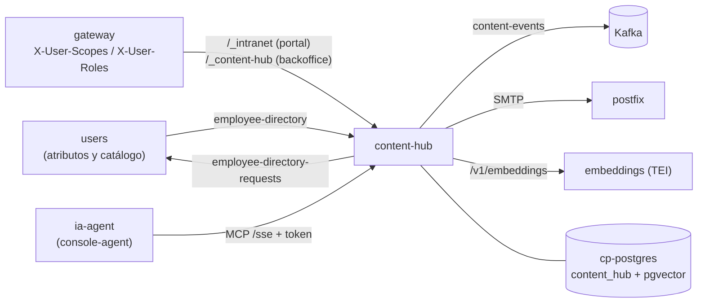
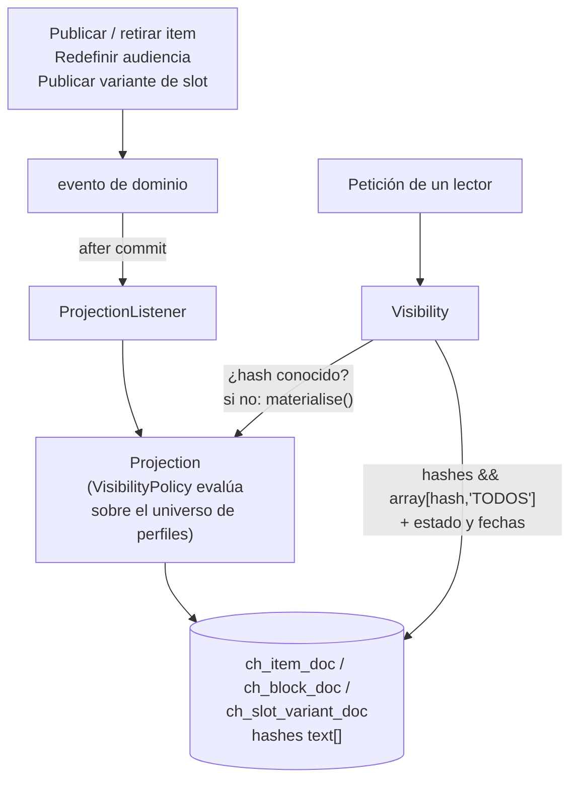
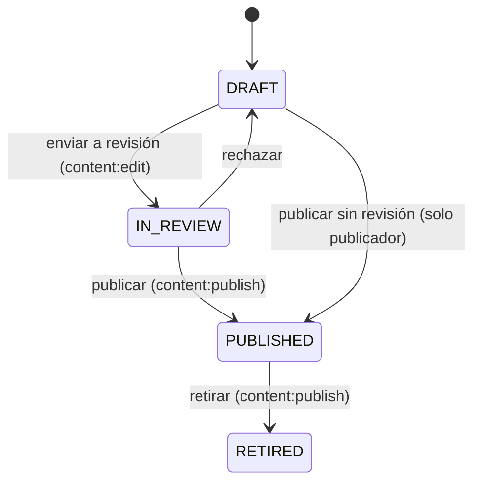

La intranet es el primer consumidor de **`content-hub`** (`supporting/content-hub`), un servicio de
contenido con **visibilidad por audiencia**: cada empleado ve solo lo que admiten sus atributos (empresa,
país, región, hotel, departamento y puesto). La spec de partida es
[`docs/specs/servicio-contenido.md`](https://github.com/miguelperezcolom/ec-demo1/blob/master/docs/specs/servicio-contenido.md);
algunos detalles cambiaron al implementarlo y esta página describe lo que hay en el código.

El principio que lo ordena todo: **todo lo que enumera contenido pasa por una única función de
visibilidad.** Páginas, bloques, menú y secciones, listados, búsqueda, favoritos, slots, newsletter, el
chat (MCP y RAG) y hasta los ficheros de la biblioteca de medios son consumidores de ella; ninguno filtra
por su cuenta.

## Componentes

Un solo servicio Spring Boot hexagonal (`domain/`, `application/`, `infra/in`, `infra/out`), puerto
**8135**, con varias puertas de entrada:

| Componente | Dónde | Qué hace |
| :--------- | :---- | :------- |
| **Portal** | `@UI("/_intranet")` (`infra/in/ui/portal`), en el shell del plano de datos (`RemoteMenu` *Intranet*) | Lo que lee el empleado: inicio, noticias, avisos, documentos, secciones, búsqueda, favoritos, pendientes |
| **Backoffice editorial** | `@UI("/_content-hub")` (`infra/in/ui/backoffice`), en la consola de control (`RemoteMenu` *Intranet*) | Contenidos, medios, secciones, audiencias, ver como, slots, newsletter, confirmaciones, directorio y visibilidad |
| **Servidor MCP** | `/sse` (`infra/in/mcp`), solo dentro del clúster | Las herramientas del chat, con el token de quien chatea |
| **Remoto de slots** | `GET /_intranet/api/slots/{key}` (`SlotController`) | La variante visible de un slot, como JSON (provisional) |
| **Medios** | `GET /_intranet/media/{id}` y `/_content-hub/media/{id}` (`MediaController`) | Los ficheros de la biblioteca, con URL firmada |
| **`embed.js`** | `GET /_intranet/embed.js` y `/_content-hub/embed.js` | Convierte los marcadores de vídeo y PDF en reproductores (ver [Seguridad](#seguridad)) |
| **Directorio** | `EmployeeDirectoryListener` | Copia local de los empleados y sus atributos, desde `employee-directory` |
| **Trabajos** | `ContentJobs` | Cruces de fechas, newsletter, embeddings del RAG y limpieza de perfiles huérfanos |

Las dos UIs están en el mismo pod; **el host es lo que separa leer de escribir**: el portal va en
`ec1.mateu.io` (cualquier usuario autenticado) y el backoffice en `console.ec1.mateu.io` (rol `ai-admin`
en el gateway, y además los permisos editoriales dentro del servicio).

## La visibilidad

### El perfil y su hash

Un **perfil** son los atributos de visibilidad de un empleado, normalizados (recortados, en mayúsculas,
vacío = ausente, en el orden de los atributos). Su **hash** (`h` + 16 hex de SHA-256 de
`COMPANY=…;HOTEL=…`) nombra a todos los que ven exactamente lo mismo. **El idioma no entra**: elige la
traducción, no lo visible. Con ~30 empleados la demo tiene unas decenas de perfiles; a escala real se
estiman 2.000–5.000.

El hash es la clave de todo: de la proyección, de las cachés (dos empleados con los mismos atributos
comparten entradas) y de los grupos de la newsletter.

### La política y la proyección

- **`VisibilityPolicy`** (dominio, sin estado) es lo **único** que evalúa expresiones de audiencia.
- **`Projection`** mantiene la proyección **sujeto → hashes que lo ven**: cada traducción publicada de un
  item, cada bloque y cada variante de slot lleva una columna `hashes text[]` con índice GIN. Una
  audiencia que no restringe nada se guarda como el token `TODOS`, para que un perfil que aparezca mañana
  la vea sin recalcular.
- **`Visibility`** es la función que llaman todos los consumidores. Nunca evalúa una expresión ni filtra
  en memoria: se asegura de que el perfil del lector está en la proyección y deja que PostgreSQL filtre
  con `hashes && array[:hash, 'TODOS']`, `status = 'PUBLISHED'`, `publish_at <= now` y
  (`expire_at` vacía o futura), **en la misma consulta** que pagina, cuenta, ordena o busca.

Reglas que salen de ahí:

- **Estado y tiempo en la consulta.** Programado y caducado no son estados ni se materializan: un item
  con fecha futura aparece a su hora sin que nadie haga nada.
- **Herencia restrictiva calculada.** La audiencia efectiva de un bloque es `página AND bloque`; se calcula
  al proyectar, no se guarda, así que se cumple aunque se redefina una audiencia con nombre.
- **Hash desconocido.** Si llega un lector con un perfil aún no materializado (alta reciente, evento del
  directorio en camino, "ver como"), antes de responder se materializa **ese** hash de forma síncrona: un
  hash contra todos los sujetos son milisegundos.
- **Usuario fuera del directorio**: se le trata sin atributos y solo ve lo que es para `TODOS`.
- **Perfiles huérfanos.** Cada hora (`content-hub.jobs.orphans`, `PT1H`) se borran de la proyección y de
  la caché los hashes que ya no tiene ningún empleado activo.
- **Consistencia eventual.** Publicar o redefinir se aplica en un hilo aparte tras el commit
  (`PROJECTION_ASYNC=true`): unos segundos. El formulario del item lo dice en *Aplicado a los lectores*.
- **Caché por hash** (Caffeine, 20.000 entradas, 10 min de red de seguridad): inicio, menú y listados. La
  invalidan los mismos eventos que recalculan la proyección y los cruces de fechas.
- **Una audiencia con nombre borrada no admite a nadie**, y una que se refiere a sí misma tampoco: el
  contenido nunca se abre por accidente.

Los medios siguen la misma regla: un fichero se sirve solo a quien ve un item publicado que lo usa
(`ch_item_media`, cruzado con la proyección).

### Las audiencias

Una audiencia es un árbol `AND`/`OR` cuyas hojas son `atributo IN (valores)`, o una **audiencia con
nombre** por referencia (nunca copiada: redefinirla cambia todo lo que la nombra). Vacía = todos los
empleados. Los atributos son una lista cerrada: `company`, `country`, `region`, `hotel`, `department`,
`jobTitle`; los valores son los códigos del catálogo del servicio de usuarios.

## Modelo de dominio

Ocho agregados, referenciados entre sí solo por id, y un servicio de dominio (`VisibilityPolicy`).

| Agregado | Contenido | Invariantes |
| :------- | :-------- | :---------- |
| **Item** (`domain/item`) | Tipo (`ARTICLE`, `PAGE`, `NOTICE`, `LINK`, `DOCUMENT`), borrador (`ItemContent`: sección, audiencia, traducciones, bloques, fechas, flags, URL), versiones inmutables | Transiciones del workflow; título en el idioma por defecto; caducidad posterior a la publicación; enlaces y documentos con URL; solo las páginas tienen bloques; ids de bloque únicos |
| **Navegación** (`domain/navigation`) | El árbol entero de secciones, con orden y nombres por idioma | Sin ciclos, orden único entre hermanas |
| **Slot** (`domain/slot`) | Clave `aplicacion.pantalla.nombre`, descripción, fallback, variantes con audiencia y prioridad | Clave inmutable, prioridad única, huérfano en vez de borrado |
| **Audiencia con nombre** (`domain/audience`) | Nombre y expresión | No se refiere a sí misma |
| **Edición de newsletter** (`domain/newsletter`) | Título, intro, items en orden, audiencia, fecha, envío por grupo | No se modifica una vez enviada |
| **Empleado** (`domain/employee`) | Atributos y hash | Solo lo escribe el consumidor del directorio |
| **Favoritos** (`domain/favorites`) | Uno por empleado, items por id | Sin duplicados |
| **Acuse** (`domain/ack`) | (item, versión, empleado, tipo `READ`/`CONFIRMATION`) | Idempotente |

### El workflow de un item

- El editor trabaja siempre sobre el **borrador**. Publicar lo congela en una **versión** nueva; editar un
  item publicado solo toca el borrador, que vuelve a pasar por revisión por su cuenta (*cambios en
  revisión*) sin afectar a lo que se ve.
- **Programado y caducado se derivan de las fechas**, no son estados.
- **Confirmación obligatoria**: `confirmationVersion` es la versión desde la que cuentan las
  confirmaciones. Al publicar una versión nueva, «exigir reconfirmar» la mueve a la nueva; si no, las
  confirmaciones anteriores siguen valiendo.
- Los items **no se borran**: se retiran.

### Permisos editoriales

| Scope | Rol de ejemplo | Qué permite |
| :---- | :------------- | :---------- |
| `content:edit` | Editor de contenido (`content-editor`) | Crear y editar, enviar a revisión |
| `content:publish` | Publicador (`content-publisher`, con `content:edit`) | Aprobar, publicar (con o sin revisión), rechazar, retirar |
| `content:admin` | Administrador (`content-admin`, los tres) | Secciones, audiencias con nombre, slots, newsletter, recalcular la proyección. Implica los otros dos |

Son permisos y roles del servicio de usuarios. `content-hub` los lee de la cabecera **`X-User-Scopes`**
que pone el gateway; sin esa cabecera (el gateway no pudo preguntar), un usuario con el rol de realm
`admin` conserva todos, para que el usuario `demo` nunca se quede fuera.

## Eventos y topics

| Topic | Sentido | Qué lleva |
| :---- | :------ | :-------- |
| `employee-directory` | users → content-hub | `EmployeeUpserted` (el empleado entero: nombre, email, activo, atributos como códigos del catálogo e idioma) y `EmployeeRemoved`; clave el id de usuario |
| `employee-directory-requests` | content-hub → users | `{"requestId", "requestedBy"}`: pide una copia completa del directorio. Se manda al arrancar con el directorio vacío, o a mano desde *Visibilidad* |
| `content-events` | content-hub → quien quiera | Los eventos de dominio: `ItemPublished`, `ItemRetired`, `ItemBecameEffective`, `ItemExpired`, `AudienceRedefined`, `SlotVariantPublished`, `NavigationChanged`, `EmployeeChanged`. Clave el sujeto. Hoy nadie los consume fuera del servicio |

Todo sale por el **outbox** de `supporting/messaging`, en la misma transacción que el cambio, y
`employee-directory` entra por el **inbox** (cada mensaje una vez, por su `eventId`). En el servicio de
usuarios el outbox ya entregaba a Keycloak; un `RoutingOutboxTransport` elige por destino (`identity` a
Keycloak, `employee-directory` a Kafka) y la clave del directorio va aparte, para que una caída de
Keycloak no lo retenga.

Dentro del servicio, los mismos eventos van a `ProjectionListener` tras el commit: publicar o retirar
reproyecta el item, redefinir una audiencia recalcula toda la proyección, una variante de slot reproyecta
el slot, y los cruces de fechas y la navegación vacían la caché.

## Almacenamiento

Base de datos **`content_hub`** en **`cp-postgres`** (la instancia con pgvector), creada por el
initContainer del manifiesto. Las tablas las crea `schema.sql` al arrancar, solo con `if not exists`
(aditivo: nada se borra ni renombra); las de outbox e inbox son de la librería de mensajería.

| Tablas | Qué guardan |
| :----- | :---------- |
| `ch_item`, `ch_navigation`, `ch_slot`, `ch_named_audience`, `ch_newsletter`, `ch_favorites` | Los agregados, como documento JSON (más las columnas por las que se lista) |
| `ch_ack` | Acuses de lectura y confirmación |
| `ch_media` | La biblioteca de medios; los ficheros subidos, en `bytea` |
| `ch_employee`, `ch_profile` | El directorio y el universo de perfiles (hash → atributos) |
| `ch_item_doc`, `ch_block_doc`, `ch_slot_variant_doc` | **La proyección**: cada traducción publicada, bloque y variante con sus `hashes text[]` (GIN) |
| `ch_item_media`, `ch_projection_state` | Qué medios usa cada item; qué versión está ya aplicada |
| `ch_chunk` | Los pasajes del RAG con su `vector(384)` |

La **búsqueda de texto** es el FTS de PostgreSQL: `ch_item_doc.tsv` (configuración `simple`, índice GIN),
consulta por **prefijo** («vacac» encuentra «vacaciones»), filtrada por visibilidad en la misma consulta:
páginas y contadores solo cuentan lo visible.

## Seguridad

- **El gateway es la frontera.** `/_intranet/**` exige token en los hosts de datos; `/_content-hub/**`,
  rol `ai-admin` en los de control. El servicio no vuelve a verificar el token de esas rutas: lee sus
  claims (`preferred_username` es el `UserId` del servicio de usuarios) y solo es alcanzable a través del
  gateway.
- **Cabeceras `X-User-Roles` y `X-User-Scopes`.** El gateway (`UserAuthorityEnrichmentFilter`) pregunta a
  `AuthService.GetAuthInfo` del servicio de usuarios por gRPC (`AUTH_GRPC_ADDRESS`, `users:9191`) y las
  añade, separadas por espacios, cacheadas 5 minutos por token. **Siempre borra primero** las que mande
  el cliente. Es de mejor esfuerzo: si `users` no contesta, la petición sigue sin ellas. El token no se
  re-firma, porque los shells y el front office lo verifican contra Keycloak.
- **Los atributos no viajan en el token**: van por el directorio, porque la newsletter, el "ver como" y el
  universo de hashes los necesitan sin que haya petición del usuario.
- **URLs firmadas para los medios.** Un `` o un `<video>` no lleva el token, así que el gateway deja
  pasar sin autenticar `GET /_intranet/media/**` y `/_intranet/embed.js` (y sus equivalentes en
  `/_content-hub`). Cada URL la firma el servicio al dibujar la página: HMAC-SHA256 de
  `id|hash|caducidad`, válida **2 horas**, con la clave `MEDIA_SECRET`. Al servirla se comprueba la firma
  **y otra vez la visibilidad** (el item pudo retirarse). Las vistas previas del backoffice firman con
  `EDITOR`, que ve toda la biblioteca.
- **Iframes.** El saneador de Mateu (DOMPurify) quita los `<iframe>`, así que un vídeo externo o un PDF se
  dibuja como un marcador `
` con un enlace (y la
  miniatura de YouTube). `embed.js`, que los shells cargan con `@Script` como `push.js`, lo cambia por el
  reproductor **solo** para `www.youtube-nocookie.com`, `player.vimeo.com`, `drive.google.com` y los
  medios propios firmados; cualquier otra cosa se queda en enlace. Del código de inserción que pega un
  editor solo se guardan el proveedor y el id: el reproductor se construye desde ellos, nunca desde lo
  pegado.
- **El HTML de los cuerpos se sanea** al guardarlo (`HtmlSanitizer`).
- **MCP.** El servidor MCP no pasa por el gateway (es interno del clúster): aquí sí se verifica el token
  que reenvía `ia-agent` contra Keycloak (`KEYCLOAK_JWKS_URI`, `KEYCLOAK_ISSUER_URI`) y una llamada sin él
  se rechaza. Cada herramienta lee como el usuario real (nunca como su "ver como").

## RAG y chat

- Cada traducción publicada se corta en **pasajes de ~700 caracteres** (`ch_chunk`). Un trabajo cada 15 s
  los manda en lotes de 32 al servicio **`embeddings`** del clúster (Text Embeddings Inference con
  `intfloat/multilingual-e5-small`, 384 dimensiones, prefijos `passage:` y `query:`) y guarda el vector en
  pgvector. Un item es visible antes de que sus pasajes estén embebidos; solo tarda unos segundos en
  encontrarlo el chat.
- La pregunta se embebe y se buscan los pasajes más cercanos (`<=>`) **unidos a `ch_item_doc` con el mismo
  filtro de visibilidad**: el agente nunca recibe un pasaje que la persona no pueda leer.
- Herramientas MCP (`IntranetMcpTools`):

| Herramienta | Qué devuelve |
| :---------- | :----------- |
| `preguntar_intranet(pregunta)` | Los 6 pasajes más relevantes, con su item y enlace (RAG) |
| `buscar_contenido(texto)` | Hasta 10 items por texto (prefijo); vacío, los últimos |
| `leer_item(id)` | El texto completo de un item, si lo puede ver, y si debe confirmarlo |
| `confirmaciones_pendientes()` | Lo que debe confirmar y aún no ha confirmado. Confirmar se hace en el portal, no desde el chat |

El servidor se registra en el plano de control de IA como el MCP **`intranet`**
(`gitops/example/ia/mcp/intranet.yaml`, SSE a `http://content-hub:8135`) y lo usa `console-agent`.

## Newsletter

Para cada edición se agrupan los destinatarios (empleados activos con email que cumplen la audiencia de
la edición) por **(hash de perfil, idioma)**; se pregunta a la función de visibilidad **una vez por grupo**
qué items de la edición ve, y se manda **un correo por grupo** con solo esos items, en su idioma. Un grupo
que no ve ninguno no recibe nada. Cada grupo queda registrado por separado: uno que falla se reintenta en
la siguiente pasada (cada 30 s) sin reenviar a los demás. Sale por el relay `postfix`; como los empleados
son ficticios, en la demo todo va a `NEWSLETTER_REDIRECT_TO`, con el grupo y el idioma en el asunto.

## Slots

Un **slot** es un hueco en la pantalla de otra aplicación donde va contenido editorial, con clave estable
`aplicacion.pantalla.nombre`. Sus variantes tienen audiencia y prioridad; el lector recibe la visible de
mayor prioridad, y sin ninguna, la aplicación pinta su fallback. Un slot que deja de aparecer en los
descriptores se marca **huérfano**, no se borra.

Mientras Mateu no publique el microfrontend resuelto en servidor y `@ContentSlot` (en desarrollo en el
repositorio de Mateu), el remoto es **REST provisional**: `GET /_intranet/api/slots/{key}` con el token del
usuario devuelve `{key, variant, priority, title, html, link, cacheKey}` o **204** (la aplicación pinta el
fallback), con `X-Content-Cache-Key` = el hash del perfil, para que la aplicación cachee por él.

## Decisiones y por qué

| Decisión | Por qué |
| :------- | :------ |
| Hecho en casa y no comprado | El filtrado afecta a menús, listados, búsqueda y chat, no solo a páginas; Mateu resuelve la UI en servidor y nunca manda al cliente lo que no se puede ver; el mismo modelo sirve para el contenido embebido en otras aplicaciones (slots) |
| Una sola función de visibilidad y una proyección materializada | Un solo sitio que pueda equivocarse; filtrar en PostgreSQL hace que la paginación y los contadores sean correctos sin cargar nada en memoria |
| Hash de perfil y no usuario | Miles de empleados se reducen a unos miles de perfiles: proyección, caché y newsletter crecen con los perfiles, no con las personas |
| Estado y fechas en la consulta | Lo programado aparece a su hora sin jobs ni recálculos; los cruces de fechas solo invalidan cachés |
| Atributos en el servicio de usuarios, por Kafka, no en el token | Hacen falta sin petición (newsletter, ver como, universo de hashes); el token no crece; un cambio de atributos se ve en segundos |
| Valores de un catálogo cerrado, país y región derivados del hotel | Una audiencia `region IN (CANARIAS)` no puede fallar por cómo se tecleó; `region` y `hotel` nunca discrepan para la misma persona |
| Permisos en `X-User-Scopes` y no en un token re-firmado | Varios backends verifican el token contra Keycloak: uno firmado por el gateway sería un 401 en todos |
| La base en `cp-postgres` | Es la que tiene pgvector, que necesita el RAG |
| Medios en la base de datos, con límite de 20 MB | Una sola copia de seguridad y la misma visibilidad; lo grande va a YouTube, Vimeo o Drive por URL |
| Marcadores + `embed.js` en vez de iframes | El saneador de Mateu quita los iframes; la lista cerrada de hosts mantiene fuera el HTML arbitrario |
| Slots por REST provisional | El microfrontend de Mateu aún no está; el contrato (clave, identidad, caché por hash) es el mismo |

## Pruebas

- `ItemTest`: el workflow y las invariantes del item.
- `VisibilityPolicyPropertiesTest` (jqwik): con expresiones y perfiles generados, **la proyección es igual a
  evaluar cada expresión para cada perfil**.
- `ConsumersTest` (Testcontainers con `pgvector/pgvector`): los criterios de aceptación de la spec —un item
  que el lector no cumple no aparece en ningún consumidor, bloques, programados y caducados sin job,
  secciones vacías, paginación, idioma de fallback, cambio de atributos y caché compartida, favoritos, slots,
  newsletter, reconfirmación, editor sin publicar, hash desconocido y proyección desde cero.
