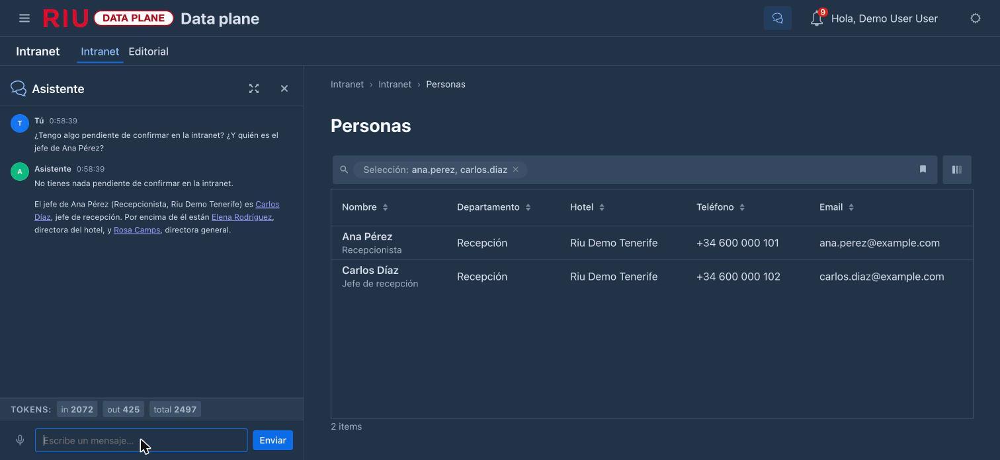

La IA de la intranet tiene **una regla que no cambia en ninguna parte: solo sabe lo que tú puedes leer**.
Cuando te responde, traduce o describe algo, trabaja **con tu identidad** (tu sesión, no una cuenta de
servicio), y lo que le llega ya está filtrado por la misma visibilidad que el portal. Un contenido que no es
para ti no existe tampoco para ella.

Ninguna de estas funciones publica nada sola: lo que propone la IA lo revisa una persona.

| Dónde | Qué hace | Quién | Agente |
| :---- | :------- | :---- | :----- |
| Portal → *Buscar* | Responde a una pregunta con los contenidos que puedes leer, citándolos | Cualquier empleado | `intranet-agent` |
| Chat de la consola | Responde, busca contenidos y personas, lista lo pendiente de confirmar | Cualquier empleado | `console-agent` (con el MCP `intranet`) |
| Editorial → un contenido, una página o un número de newsletter | **Traducir con IA** los idiomas que faltan | Editores | `intranet-translator` |
| Editorial → *Salud* | **Sugerir texto alternativo con IA** para una imagen | Editores | `intranet-alt-text` |

## Para el empleado

### Preguntar en el buscador

En *Buscar*, si lo que escribes parece una pregunta («¿cuántos días de vacaciones tengo?», «qué hago si
pierdo la tarjeta del hotel»), sale arriba una **Respuesta de la IA**, redactada **solo con contenidos que
puedes leer**, y debajo los contenidos en los que se apoya, como enlaces numerados `[1]`, `[2]`… Si escribes
solo unas palabras, pulsa **Preguntar a la IA** para pedirla: la IA no gasta nada que no hayas pedido.

- Compruébala en las fuentes: es un resumen, y las fuentes mandan.
- Si un número no corresponde a un contenido que se le mandó, se quita: la IA no puede inventarse una fuente.
- Si la IA no está disponible, se dice en una línea y los resultados de la búsqueda siguen ahí.

![La respuesta de la IA en el buscador, con su fuente citada [1] y el aviso de que es generada.](../../../assets/intranet/ia01-respuesta-buscador.jpg)

La búsqueda en sí no necesita la IA: busca **por palabras** y **por significado** a la vez («días libres»
encuentra la política de vacaciones). Ver [Buscar](/intranet/manual-portal/#buscar).

### El chat

El chat de la consola (el globo de la barra superior) puede consultar la intranet con tu identidad:

- «¿Qué dice la política de protección de datos sobre las brechas?» — busca los fragmentos más relevantes
  y responde citando cada contenido con su enlace.
- «Busca avisos sobre turnos» — busca por palabras y te da la lista.
- «Léeme el aviso de cierre de la piscina» — lee un contenido entero, si es para ti.
- «¿Tengo algo pendiente de confirmar?» — lista lo que debes confirmar y aún no has confirmado.
- «¿Quién es el jefe de recepción de Tenerife?», «¿a quién reporta Ana Pérez?» — busca en el directorio y
  te da la ficha (puesto, dónde trabaja, contacto, jefes y quién le reporta).

Desde el chat **no se confirma** una lectura ni se cambia nada: abre el enlace y hazlo en el portal. Un
contenido recién publicado tarda unos segundos en estar disponible para el chat (lo que tarda en
indexarse, ver [Los RAG](#los-rag-con-qué-datos-responde)).

### Leer en tu idioma

No hace falta la IA para leer en tu idioma: lo que está traducido sale en el tuyo, y lo que no, en el
original. Las traducciones las hacen los editores, a veces con ayuda de la IA, y las revisan antes de
publicar.

## Para el editor

### Traducir con IA

Un contenido, una página o un número de newsletter se escriben en varios idiomas (español, inglés,
alemán). **Traducir con IA** rellena lo que a cada idioma le falta a partir del idioma por defecto:

- **En el formulario** (*Editorial → Contenidos*, la barra de arriba): el título, el resumen y el cuerpo de
  los idiomas que aún no tienen título, y los bloques de una página (títulos, HTML, textos de los enlaces).
- **En el editor visual** (*Editar sobre la página* o *Editar sobre el número*): elige un idioma en el
  selector que no sea el por defecto y pulsa *Traducir con IA*: rellena lo que a ese idioma le falta, y lo
  ves en la página.

Lo que vuelve **se comprueba con dureza antes de ponerlo**: tiene que conservar el formato del original (las
mismas etiquetas, en el mismo orden), los mismos enlaces e imágenes y las mismas marcas de medios. Si no, no
cambia nada y te lo dice. Lo traducido queda en el formulario: **revísalo y guarda**; nada se publica
desde aquí, y el workflow de siempre sigue (revisión, aprobación…).

En una **newsletter**, cada número se traduce igual, en el editor del número: el idioma por defecto es el
primero de la newsletter, y cada lector la recibe en el suyo si está traducida (si no, en el primero).

### Texto alternativo de las imágenes

*Salud del contenido* avisa de las **imágenes sin texto alternativo** (el texto que leen los lectores de
pantalla y que sale si la imagen no carga). En una imagen de la biblioteca:

1. **Sugerir texto alternativo con IA**: la imagen (hasta 5 MB) va a la IA con tu sesión, junto a su
   título y dónde se usa, y vuelve una frase corta en español.
2. Revísala y corrígela si hace falta.
3. **Aplicar el texto alternativo**: desde ese momento, el portal, las newsletters y el editor la usan.

La sugerencia nunca se aplica sola. Si la IA no ha podido ver la imagen, lo dice y lo escribes a mano.

### Newsletters

Una newsletter usa la IA igual que la intranet: **Traducir con IA** en sus números y páginas, y las
imágenes de sus números entran en *Salud del contenido*. Sus artículos y páginas publicados son contenidos de
la intranet: se buscan, el chat los encuentra y la respuesta del buscador los cita, **siempre para quien
cumpla la audiencia de la newsletter**. Lo que ve cada destinatario en el correo es lo que puede ver en la
intranet; la IA no cambia eso.

## Los RAG: con qué datos responde

Un *RAG* (recuperación + generación) es responder con la ayuda de unos textos buscados para la ocasión, en
vez de con lo que el modelo «sabe». En esta demo hay **dos tipos de fuentes**, y la diferencia importa:

| | El índice de la intranet | Las fuentes RAG del plano de control |
| :- | :----------------------- | :----------------------------------- |
| Qué guarda | Todo lo publicado en la intranet y las newsletters, cortado en pasajes | Textos que alguien mete a mano (p. ej. el *Ops handbook* del despliegue) |
| Dónde | En content-hub (pgvector, en su base de datos) | En el plano de control de IA (pgvector) |
| Quién ve qué | **Cada persona, solo los pasajes que puede leer** (el filtro de visibilidad va en la misma consulta) | Todo el que use el agente ve lo mismo |
| Cómo se usa | Buscador, respuesta de la IA y las herramientas del MCP `intranet` | Un agente compuesto con la fuente la recibe como herramienta |
| Se actualiza | Solo: cada traducción publicada se indexa en unos segundos; lo despublicado sale | Con *Content → Ingest text* en la fuente |

Por eso la intranet **no es** una fuente RAG del plano de control: una fuente del plano la ven igual todos los
que usan el agente, y la intranet tiene que responder distinto a cada persona.

Cómo se construye el índice de la intranet: cada texto publicado se corta en pasajes de unos 700 caracteres;
un trabajo los manda cada 15 segundos al servicio `embeddings` del clúster (un modelo multilingüe pequeño,
`intfloat/multilingual-e5-small`, sin salir del clúster ni pagar a nadie), y el vector se guarda junto al
pasaje. Al buscar, la pregunta se convierte en vector y se buscan los pasajes más cercanos **entre los que
puede leer quien pregunta**. Los detalles, en [Arquitectura → RAG y chat](/intranet/arquitectura/#rag-y-chat).

## El MCP: la intranet en otros asistentes

MCP (*Model Context Protocol*) es la forma estándar de darle herramientas a un asistente de IA. content-hub
publica un **servidor MCP**, registrado en el plano de control de IA como **`intranet`**, y cualquier agente
del catálogo que lo tenga en su lista puede usar sus herramientas:

| Herramienta | Qué hace |
| :---------- | :------- |
| `preguntar_intranet(pregunta)` | Los 6 pasajes más relevantes para la pregunta, con su contenido y enlace (el RAG) |
| `buscar_contenido(texto)` | Hasta 10 contenidos por palabras; sin texto, los últimos |
| `leer_item(id)` | El texto completo de un contenido, si lo puedes ver, y si debes confirmarlo |
| `confirmaciones_pendientes()` | Lo que debes confirmar y no has confirmado |
| `buscar_personas(texto)` | Personas del directorio por nombre, puesto, departamento, hotel o región |
| `ficha_persona(id)` | La ficha de una persona: puesto, dónde trabaja, contacto, sus jefes y quién le reporta |
| `mis_newsletters()` | Las newsletters que son para ti: si la recibes, qué secciones, su último número y su enlace |
| `numeros_newsletter(newsletter)` | Los números ya enviados de una newsletter, del último al primero |
| `leer_numero(newsletter, numero?)` | Un número tal como te llega (asunto, fecha, sus bloques y los items que puedes ver, su enlace); sin número, el último |

- **Todas trabajan con el token de quien chatea**: el plano de control de IA lo reenvía, y content-hub lo
  verifica. Sin token, no responden. Un asistente no puede saltarse la visibilidad, porque no la aplica él.
- **Solo leen.** Confirmar, comentar, aprobar, publicar o suscribirse a una newsletter se hace en el portal.
  De las newsletters solo salen **números ya enviados**: nunca un borrador ni uno programado.
- Hoy lo usa **`console-agent`** (el chat de la consola). Para dárselo a otro agente (p. ej.
  `reception-agent`): añadir `intranet` a su lista de MCP en el catálogo, o desde el plano de control de IA
  (*Agentes*). Ver [Operación → Registro del MCP](/intranet/operacion/#registro-del-mcp).

### Desde Claude o Antigravity

El mismo servidor se puede usar **desde tu ordenador**, en Claude Code, Claude Desktop o Google Antigravity:
le preguntas a tu asistente por la intranet o por las newsletters y responde con lo que tú puedes ver.

| | |
| :- | :- |
| Dirección (recomendada, *streamable HTTP*) | `https://intranet.ec1.mateu.io/_intranet/mcp` (en local, `http://intranet.localhost:8800/_intranet/mcp`) |
| Dirección SSE | La misma, terminada en `/_intranet/mcp/sse` |
| Identidad | Tu token de Keycloak en la cabecera `Authorization: Bearer …`. Sin él, la respuesta es 401 |

1. **Inicia sesión una vez** con `python3 deploy/demo/intranet-mcp-token.py login`: abre el navegador para
   que entres con tu usuario (el cliente `intranet-mcp` de Keycloak). Después, el script da un token nuevo cada
   vez que se le pide (duran 8 horas) sin volver a pedir la contraseña.
2. **Configura tu asistente**:
   - **Claude Code**: `claude mcp add-json intranet '{"type":"http","url":"…/_intranet/mcp","headersHelper":"python3 …/deploy/demo/intranet-mcp-token.py header-json"}'`
     — pide un token nuevo cada vez que conecta.
   - **Claude Desktop**: en `claude_desktop_config.json`, un servidor que arranca `npx mcp-remote <dirección>
     --header "Authorization:Bearer $(python3 …/intranet-mcp-token.py)"`. Un *conector personalizado* (solo la
     URL) **no** sirve: pediría OAuth, que este servidor no ofrece.
   - **Google Antigravity**: en `mcp_config.json`, `serverUrl` con la dirección y `headers` con la cabecera,
     o el mismo `mcp-remote` que Claude Desktop.
3. Pregunta: «¿qué trae el último boletín de la intranet?», «¿tengo algo pendiente de confirmar?», «¿quién es
   el jefe de recepción de Tenerife?».

Los ficheros exactos, el script y los problemas típicos (en local, que `*.localhost` no resuelva para las
herramientas de Node: hay que añadirlos a `/etc/hosts`), en
[Operación → El MCP desde clientes de escritorio](/intranet/operacion/#el-mcp-desde-clientes-de-escritorio).

:::note
Los enlaces de las herramientas de newsletter son completos (abren el portal). Los de las demás herramientas
son rutas del portal (`/intranet/noticias/…`): en un asistente de escritorio hay que anteponerles la dirección
de la intranet.
:::

## Para el administrador

**content-hub no tiene clave de ningún modelo.** Toda la IA pasa por el **plano de control de IA**, que
decide el modelo, guarda la credencial y apunta el consumo a nombre de quien llama (cuenta para sus
presupuestos). Cada llamada es una conversación nueva: lo que pregunta un empleado no entra en el historial
de otro.

Agentes que tienen que existir en el catálogo del plano de control (*Agentes*), sin herramientas ni RAG:

| Agente | Para qué | Notas |
| :----- | :------- | :---- |
| `intranet-agent` | La respuesta del buscador | Responde solo con los pasajes que se le mandan, citándolos `[n]` |
| `intranet-translator` | Traducir con IA | Devuelve JSON con título, resumen y cuerpo |
| `intranet-alt-text` | Sugerir texto alternativo | Su modelo tiene que **ver imágenes** (Claude lo hace) |

Si falta uno, o falla, el usuario ve un aviso breve y todo lo demás sigue funcionando; el motivo queda en el
log de content-hub. Los prompts sugeridos y la configuración (URLs y tiempos de espera de cada agente), en
[Operación → La IA](/intranet/operacion/#la-ia-agentes-del-plano-de-control).

:::caution[En local]
Los tres agentes viven solo en la base de datos del plano de control, no en el repositorio, y `up.sh`
vuelve a poner los agentes en el modelo por defecto del despliegue: en local hay que volver a apuntarlos al
modelo que tenga credencial (ver [Operación → En local](/intranet/operacion/#en-local)).
:::
