Una newsletter es **un sitio más**, como la intranet pero suyo: tiene su nombre y su logo, sus colores, **su
propio menú**, sus **secciones**, sus **páginas** («Quiénes somos», «Contacto») y sus **números** (nº 1,
nº 2…). Cada número llega por correo y tiene además su **página permanente** en el portal, con lo mismo que
el correo.

La regla de siempre también aquí: **a cada uno le llega solo lo que puede ver en la intranet**. Dos personas
del mismo número pueden recibir correos distintos, porque cada una ve los contenidos de su audiencia.

## Para el lector

### Mis newsletters

*Intranet → Newsletters* (en el menú, o `/intranet/newsletters`) lista las newsletters que son para ti, si
las recibes y su último número. Abrir una lleva a su sitio.

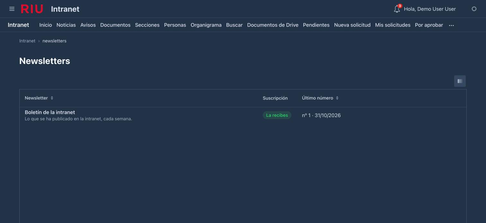

### El sitio de una newsletter

Cada newsletter se lee en `/intranet/n/{su id}`, con su cabecera y su menú:

- **Inicio**: el último número, tal como te llegó.
- **Sus secciones** (si las tiene en el menú): lo que han traído los números en esa sección.
- **Números anteriores**: el archivo, del más reciente al más antiguo. Cada número tiene su enlace
  permanente; es el que abre «Ver en el navegador» del correo.
- **Sus páginas**: «Quiénes somos» y las que haya escrito el equipo de la newsletter.

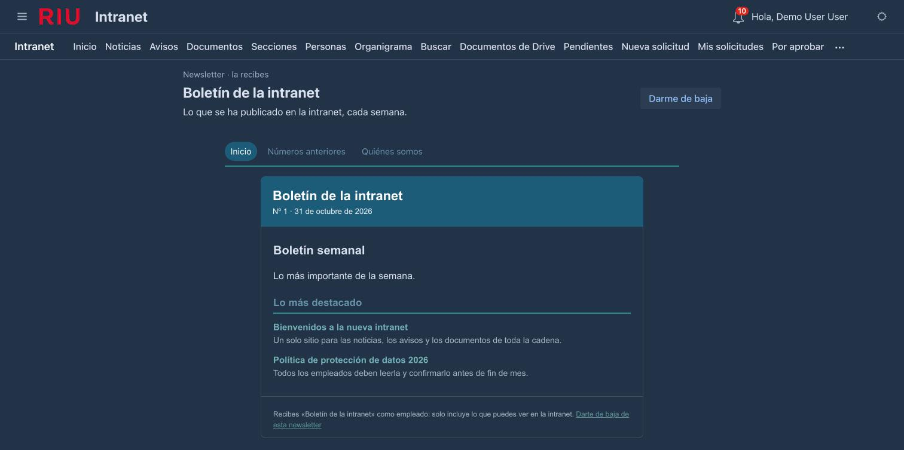

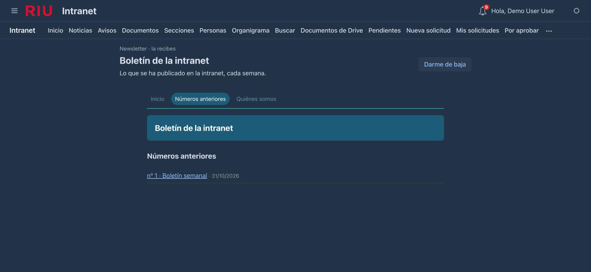

En Redwood es el mismo sitio, con su estilo:

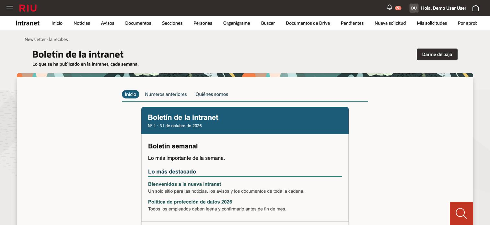

### Suscribirte o darte de baja

En la página de la newsletter:

- **Darme de baja** / **Suscribirme**: solo para esa newsletter; las demás siguen igual. El enlace
  «Darte de baja de esta newsletter» del pie de cada correo lleva aquí.
- **Qué secciones recibo**: marca las que te interesan; ninguna marcada, todas.

*Mis preferencias* lista las newsletters que recibes, cada una con el enlace a su página.

### El correo

El correo es el mismo número: la cabecera con la identidad de la newsletter, sus bloques y sus secciones, y al
pie **«Ver en el navegador»** (su página permanente) y **«Darte de baja de esta newsletter»**. Un vídeo o un
documento no se pueden ver dentro de un correo: salen como enlace a la versión web, donde sí se ven. Lo mismo
una pantalla de otra aplicación.

Lo recibes **en tu idioma** si el número está traducido; si no, en el primero de la newsletter.

:::note[En la demo]
Todos los correos van a un único buzón de redirección, como un solo mensaje con una parte por grupo de
destinatarios. Nadie recibe nada de verdad.
:::

### Buscarla y preguntar por ella

Los artículos y páginas publicados de una newsletter son contenidos de la intranet: salen en *Buscar*, el chat
los encuentra y la respuesta de la IA los cita, siempre que seas de su audiencia. Y tu asistente (el chat de la
consola, o Claude o Antigravity en tu ordenador) puede decirte qué newsletters recibes y leerte el último número
con las herramientas `mis_newsletters`, `numeros_newsletter` y `leer_numero`. Ver
[La IA en la intranet](/intranet/manual-ia/).

## Para el editor

Las newsletters se llevan en *Editorial → Newsletters* y *Editorial → Números* (consola del plano
de datos, permisos `content:*`). El menú de cada sitio, en la consola de control.

### Las newsletters

*Editorial → Newsletters* lista las newsletters: audiencia, periodicidad, si está activa, cuántos números tiene y
el último enviado.

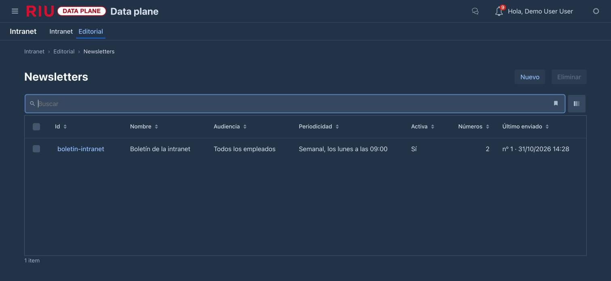

Al abrir una (o con **Nuevo**):

| Apartado | Qué es |
| :------- | :----- |
| **Audiencia** | Quién la ve y la recibe: una audiencia con nombre o atributos (empresa, país, región, hotel, departamento, puesto). «Quién lo verá» dice cuántos empleados son |
| **Newsletter** | Nombre, descripción, idiomas en que se escribe (el primero es el de por defecto), activa |
| **Identidad** | Logo (una imagen de la biblioteca de medios), color principal y de los enlaces, cabecera y pie (texto con formato) |
| **Secciones** | Las del sitio. Cada una puede **tomar lo publicado en secciones de la intranet** (p. ej. «Lo más destacado» ← Empresa, Personas, Operaciones…); además va a ella lo que se escriba en la propia sección |
| **Maqueta de cada número** | Los bloques con los que empieza un número nuevo: los de siempre (HTML, banner, destacado, enlaces, medio, listados…, cada uno con su audiencia, que solo estrecha) y **«Sección de la newsletter»**, que pone los items del número en esa sección. Vacía: una introducción y un bloque por sección |
| **Periodicidad** | Sin periodicidad (números a mano), semanal (día y hora) o mensual (día y hora), hora de Madrid |
| **Números y páginas** | Sus números (con aperturas y clics) y sus páginas |

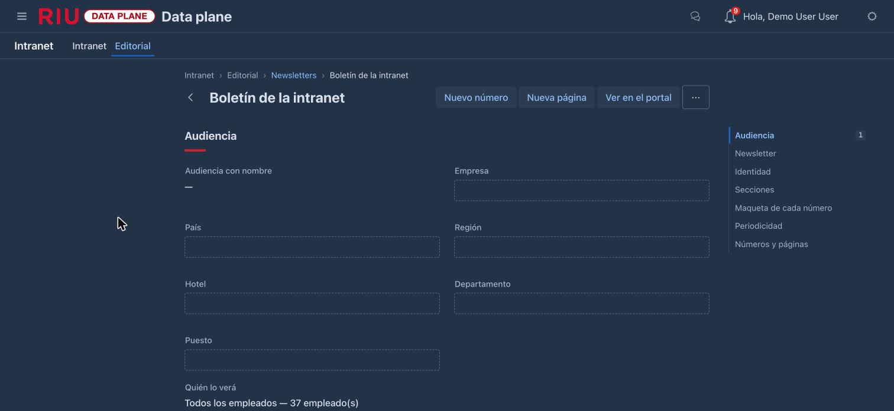

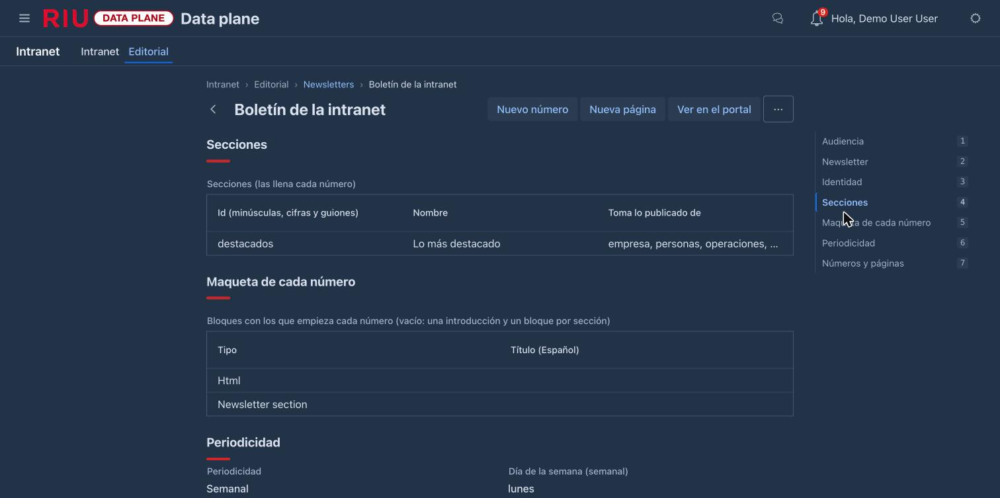

Acciones:

- **Nuevo número**: lo abre ya relleno, con la maqueta y, en cada sección, lo publicado desde el número anterior
  que vea alguien de su audiencia, lo más reciente primero.
- **Nueva página**: una página del sitio de la newsletter. Se escribe, se revisa y se publica como cualquier
  contenido (también *Editar sobre la página*); publicada, sale al final de su menú.
- **Ver en el portal**: el sitio, como lo ve un lector.

**Periodicidad automática.** Con una periodicidad, cuando llega el momento aparece **solo el borrador del número
siguiente**, ya relleno, para que alguien lo revise. Con **«Enviar cada número sin revisión»** (pide
`content:publish`) además se programa en el acto. Un mismo momento nunca crea dos números; si el servicio
estuvo parado varias semanas, se crea uno, no varios. **Próximo número** dice cuándo.

### El menú del sitio

El menú de una newsletter empieza con su inicio, sus secciones, sus números anteriores y sus páginas. Para
reordenarlo, quitar entradas o añadir otras (una página, un número concreto, un enlace, una pantalla de otra
aplicación): *Consola de control → Intranet → Menús*, eligiendo el sitio de la newsletter. Funciona igual que el
de la intranet: ver [Menús](/intranet/manual-backoffice/#menús).

### Un número

*Editorial → Números* lista todos los números (newsletter, nº, fecha, asunto, estado, aperturas,
clics); **Nuevo** pide la newsletter y abre su número siguiente.

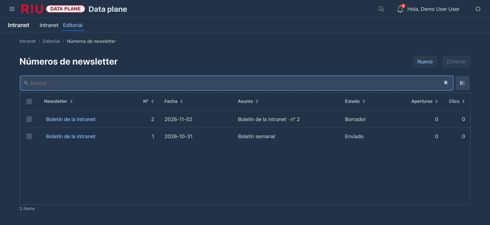

Un número tiene:

- **Asunto**, **fecha** y **Enviar el** (vacío: al programar).
- **Bloques**: como una página, también en varios idiomas.
- **Items de cada sección**, en orden. **Añadir lo nuevo** suma lo publicado desde que se abrió.
- **Destinatarios**: los grupos (perfil, idioma, secciones que quieren) con cuántos son y cuántos items ve cada
  uno. Cada grupo recibe **solo lo que puede ver**, con los bloques cuya audiencia cumple; un grupo que no ve nada
  no recibe nada. Quien se dio de baja no está en ninguno.
- **Aperturas, clics y vista previa**: totales por hotel y departamento (por grupo, nunca por persona) y el correo
  tal como sale para el primer grupo.

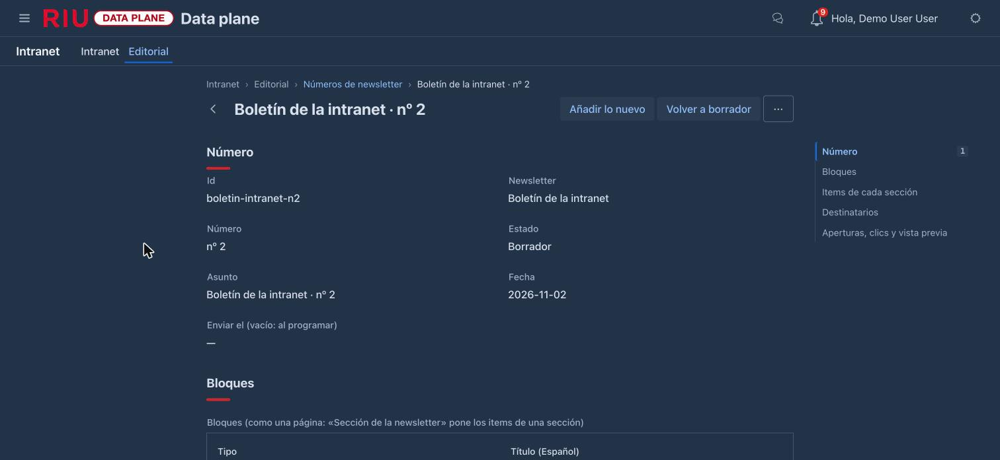

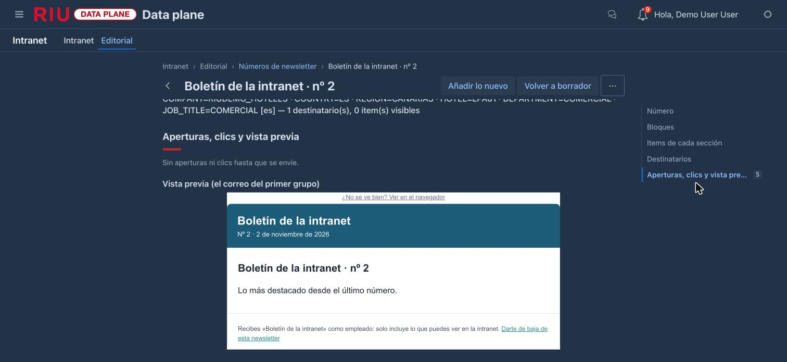

**Editar sobre el número** abre el mismo editor visual de las páginas: se escribe sobre el propio número, se
añaden y mueven bloques, se elige el idioma y se ve **como lo vería un perfil** («Ver como»). Guardar cambia el
número; la prueba y el envío siguen en su formulario («Volver al número»).

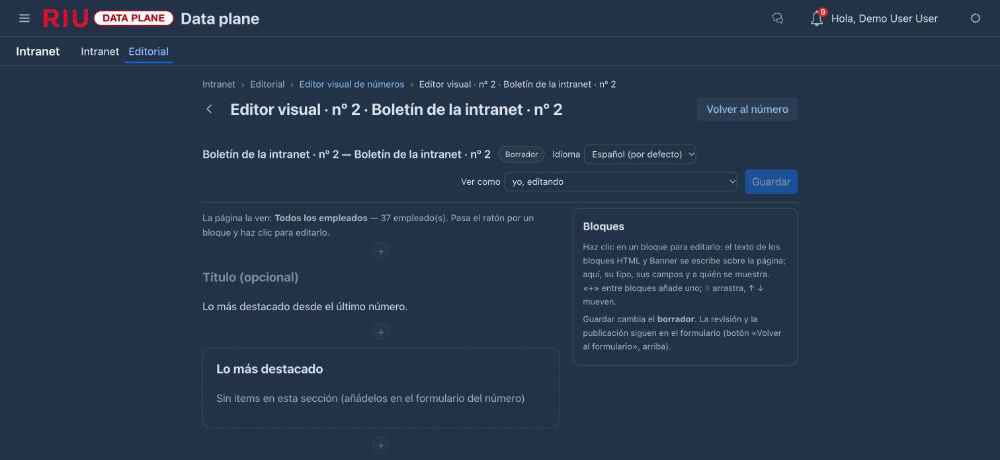

### Estados y envío

**Borrador → Programado → Enviado**, o **Cancelado**. Cada número enseña solo las acciones de su estado:

| Estado | Acciones |
| :----- | :------- |
| Borrador | Añadir lo nuevo, Editar sobre el número, **Enviar prueba**, **Programar**, Cancelar |
| Programado | **Volver a borrador**, Cancelar, Enviar prueba; **Reintentar el envío** si se ha detenido |
| Enviado / Cancelado | Ninguna: ya no cambia |

- **Enviar prueba** te lo manda a ti (tu perfil, todas las secciones; en la demo, al buzón de redirección) sin
  registrar nada.
- Si un grupo no sale, se reintenta tras 1 minuto, 5, 15, 1 hora y 6 horas. Después el envío se detiene: el
  número lo dice en su estado, cada grupo muestra su error y **Reintentar el envío** envía los que faltan
  (`content:publish`). Los grupos que ya salieron no se repiten.
- **Programar**, **Volver a borrador** y **Cancelar** piden `content:publish`. Programado, sale en menos de un
  minuto desde su hora (o ya, si no tiene).
- Si un grupo falla se reintenta solo ese.

### Varios idiomas y la IA

El idioma por defecto de un número es el primero de la newsletter. Para los demás: el selector de idioma del
editor visual y **Traducir con IA**, que rellena lo que a ese idioma le falta; se revisa y se guarda. Las
imágenes de los números entran en *Salud del contenido*, donde la IA sugiere su texto alternativo. Ver
[La IA en la intranet](/intranet/manual-ia/).

### La newsletter de la demo

**«Boletín de la intranet»**: para todos los empleados, semanal (los lunes a las 9), con una sección, «Lo más
destacado», que toma lo publicado en las secciones de la intranet. Su nº 1 está enviado y su nº 2 en borrador.
