## 1. Qué es y dónde se usa

**content-hub** es un servicio de contenido con **visibilidad por audiencia**: cada noticia, aviso, página, documento o enlace declara a quién va dirigido (por empresa, país, región, hotel, departamento, puesto o idioma) y solo lo ve quien cumple esa audiencia. Todo lo que enumera contenido —el menú, los listados, la búsqueda, los favoritos, los slots, la newsletter y el asistente— pasa por la misma función de visibilidad.

La **intranet** es su primer consumidor. El servicio se usa hoy en cinco sitios:

| Dónde | Qué se ve | Para quién |
|---|---|---|
| Portal de la intranet (host propio) | Solo el portal del empleado | Todos los empleados |
| Plano de datos, menú **Intranet** | El portal y, con permiso `content:*`, el menú **Editorial** | Empleados y equipo editorial |
| Consola de control, menú **Intranet** | Configuración: secciones, audiencias, slots, directorio, visibilidad | `ai-admin` + `content:admin` |
| Inicio del plano de datos y del front office | Slots de contenido («Novedades», «Destacado») | Según la audiencia de cada variante |
| Agentes de IA (console-agent, reception-agent) | Herramientas MCP de consulta | Con el token del usuario |

:::note
La especificación completa está en `docs/specs/servicio-contenido.md`. Esta página describe lo que hay desplegado en la demo local.
:::

## 2. Direcciones y usuarios de prueba

### Direcciones

| Qué | URL |
|---|---|
| Portal de la intranet (Vaadin) | `http://intranet.localhost:8800` |
| Portal de la intranet (Redwood) | `http://rw-intranet.localhost:8800` |
| Plano de datos: portal + Editorial | `http://ec1.localhost:8800/intranet/inicio` · Editorial: `…/editorial/contenidos` |
| Plano de datos con sus nombres nuevos | `http://ws.localhost:8800` · `http://workspace.localhost:8800` |
| Consola de control: configuración | `http://console.localhost:8800/intranet/secciones` |
| Front office (slot «Destacado») | `http://front.localhost:8800` |
| Keycloak (realm `ec-demo1`) | `http://auth.localhost:8800` |

### Usuarios

Todos los usuarios de prueba comparten la contraseña de la demo local: la de `DEMO_PASSWORD` en `~/.local/share/ec-demo1-local/credentials.env` (solo existe en este entorno local; esta página no la incluye).

| Usuario | Quién es | Atributos | Para qué usarlo |
|---|---|---|---|
| `editora` | Eva Morales | RRHH, técnica de RRHH, es · rol *Editor de contenido* (`content:edit`) | Redactar y enviar a revisión. No puede publicar. |
| `publicador` | Pablo Ortega | Dirección, es · rol *Publicador de contenido* (`content:edit`, `content:publish`) | Publicar, retirar y gestionar el contenido de los slots. |
| `ana.perez` | Ana Pérez | Hotel TFS01 (Tenerife, Canarias), Recepción, recepcionista, es | Empleada de recepción en Canarias: ve el aviso de turnos de Canarias. |
| `klaus.schmidt` | Klaus Schmidt | Hotel PMI01 (Mallorca), Recepción, recepcionista, de | Recepción fuera de Canarias, en alemán: no ve ese aviso. |
| `demo` | Demo User | Rol de realm `admin` y `ai-admin` | Consola de control (configuración) y front office. |

:::note
El directorio de la demo tiene unos 35 empleados (TFS01, LPA01, PMI01, MRU01, CUN01 y servicios centrales). Solo los de la tabla tienen contraseña en Keycloak; para entrar con otro, ver el apartado 10.
:::

## 3. El portal del empleado

Se entra por `http://intranet.localhost:8800` (o por el menú **Intranet** del plano de datos). La barra superior tiene: **Inicio**, **Noticias**, **Avisos**, **Documentos**, **Secciones**, **Buscar**, **Mis favoritos** y **Pendientes**.

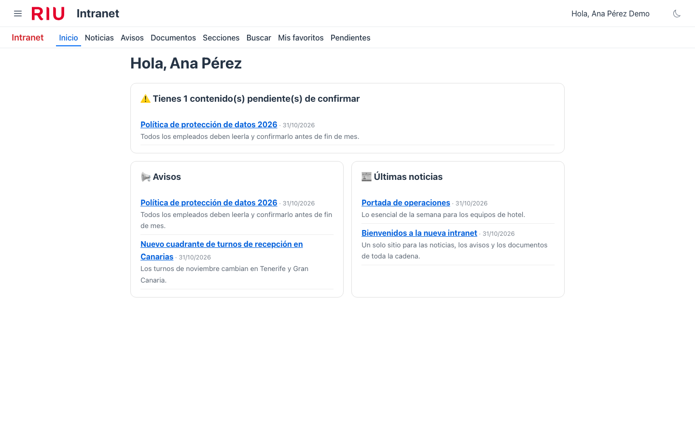

*Inicio de Ana Pérez (recepción, Canarias): un contenido pendiente de confirmar, los avisos que le tocan —incluido el cuadrante de turnos de Canarias— y las últimas noticias.*

- **Inicio**: lo pendiente de confirmar, los avisos y las últimas noticias visibles para el usuario.
- **Noticias / Avisos / Documentos**: listados filtrados por visibilidad, con su paginación (los contadores solo cuentan lo visible).
- **Secciones**: el árbol de navegación; una sección sin nada visible para el usuario no aparece.
- **Buscar**: búsqueda de texto completo sobre lo que el usuario puede ver.
- **Mis favoritos**: lo marcado con el botón *Favorito*; si un item deja de ser visible desaparece, y vuelve si vuelve a serlo.
- **Pendientes**: lo que exige confirmación de lectura y aún no se ha confirmado.

  

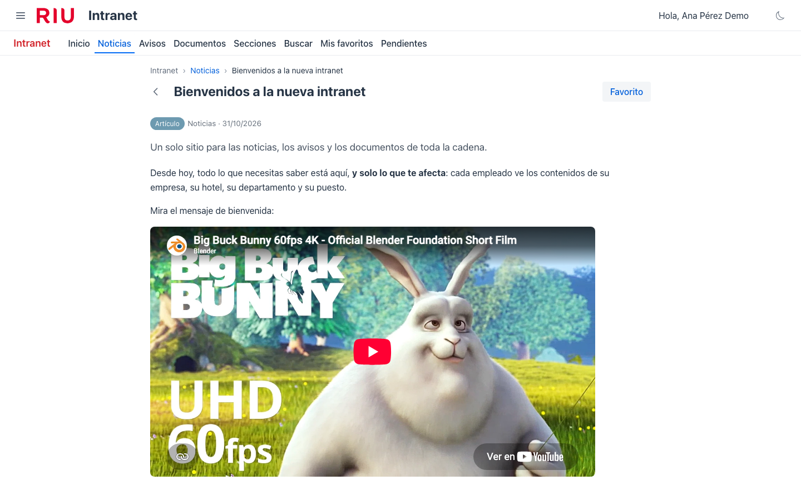

*Un artículo, con sus botones de favorito.*

  

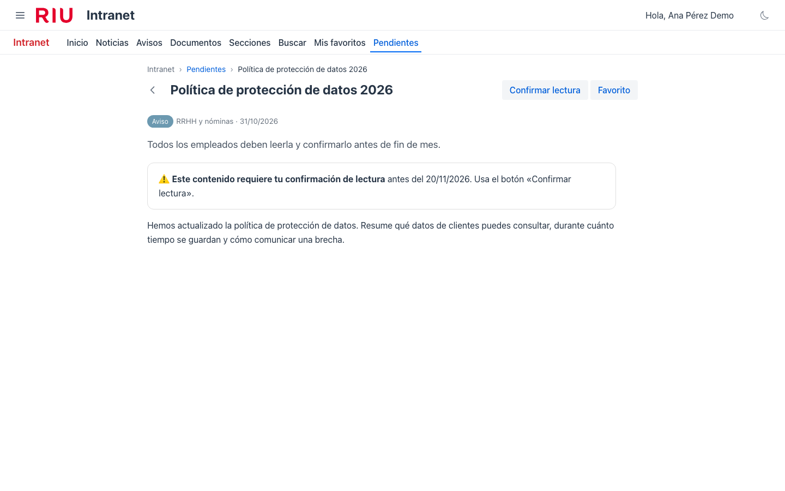

*Un aviso con confirmación obligatoria: botón «Confirmar lectura» y fecha límite.*

  

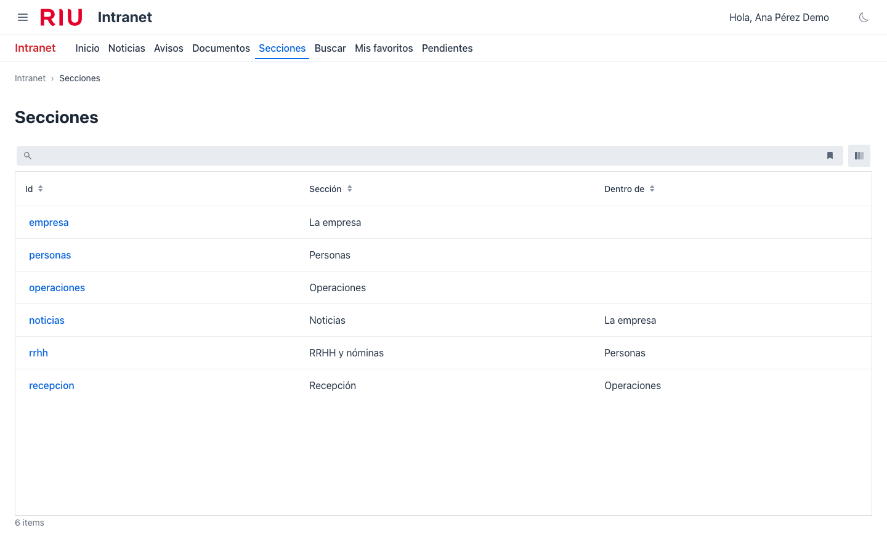

*Secciones visibles para el usuario.*

  

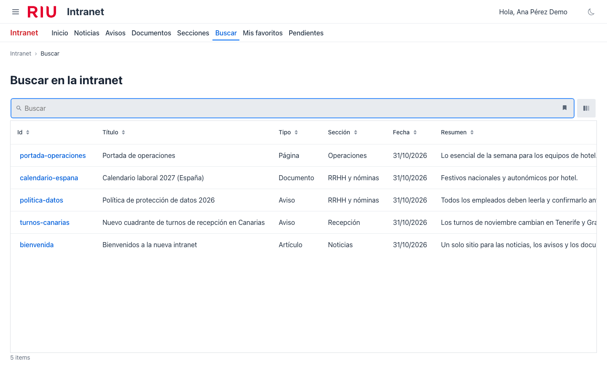

*Búsqueda en la intranet.*

## 4. La misma intranet, otro perfil

La visibilidad se decide por los **atributos del empleado** (los mantiene el servicio de usuarios y llegan a content-hub por Kafka, tema `employee-directory`), nunca por el token. Comparar dos perfiles es la forma más rápida de verlo:

  

***Ana Pérez** — Recepción, Canarias: ve «Nuevo cuadrante de turnos de recepción en Canarias» (audiencia con nombre *Recepción Canarias*).*

  

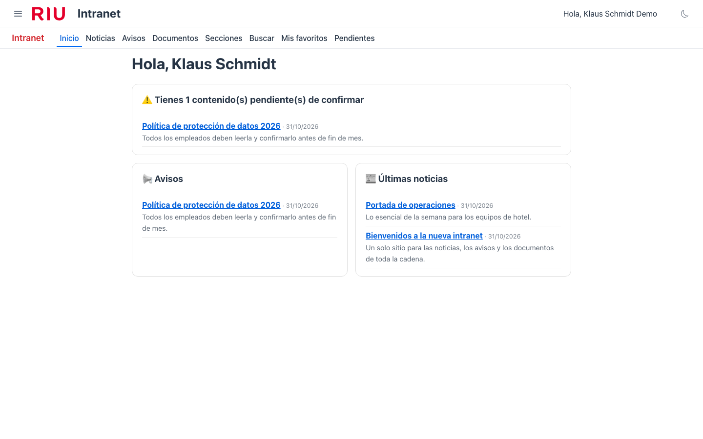

***Klaus Schmidt** — Recepción, Mallorca, en alemán: no ve ese aviso, y lo que tiene traducción lo lee en su idioma (o en el de fallback).*

El contenido de la semilla está pensado para enseñar diferencias:

| Item | Tipo | Audiencia | Qué demuestra |
|---|---|---|---|
| Bienvenidos a la nueva intranet | Artículo | Todos | Traducción es/en |
| Nuevo cuadrante de turnos de recepción en Canarias | Aviso | Recepción Canarias | Audiencia con nombre (AND de departamento y región) |
| Carta de otoño: fichas técnicas | Artículo | Equipos de cocina | Audiencia por departamento |
| Objetivos de ocupación del cuarto trimestre | Artículo | Dirección de hotel | Audiencia por puesto |
| Calendario laboral 2027 (España) | Documento | Hoteles de España | País + empresa |
| Cursos de idiomas para hoteles internacionales | Artículo | País MU o MX | Audiencia ad hoc |
| Política de protección de datos 2026 | Aviso | Todos | Confirmación obligatoria (20 días) |
| Gala de Navidad 2026 | Artículo | Todos | **Programado**: invisible hasta dentro de 30 días |
| Campaña de verano: últimos días | Aviso | Todos | **Caducado**: ya no se ve en ningún sitio |
| Portada de operaciones | Página | Todos | Bloques; uno solo para Recepción |

## 5. Trabajo editorial (menú Editorial)

En el plano de datos (`http://ec1.localhost:8800/editorial/contenidos`) el menú **Editorial** aparece junto a **Intranet** solo a quien tiene un permiso `content:*`. Cada pantalla comprueba además su propio permiso, así que una URL tecleada se rechaza igual que una entrada oculta.

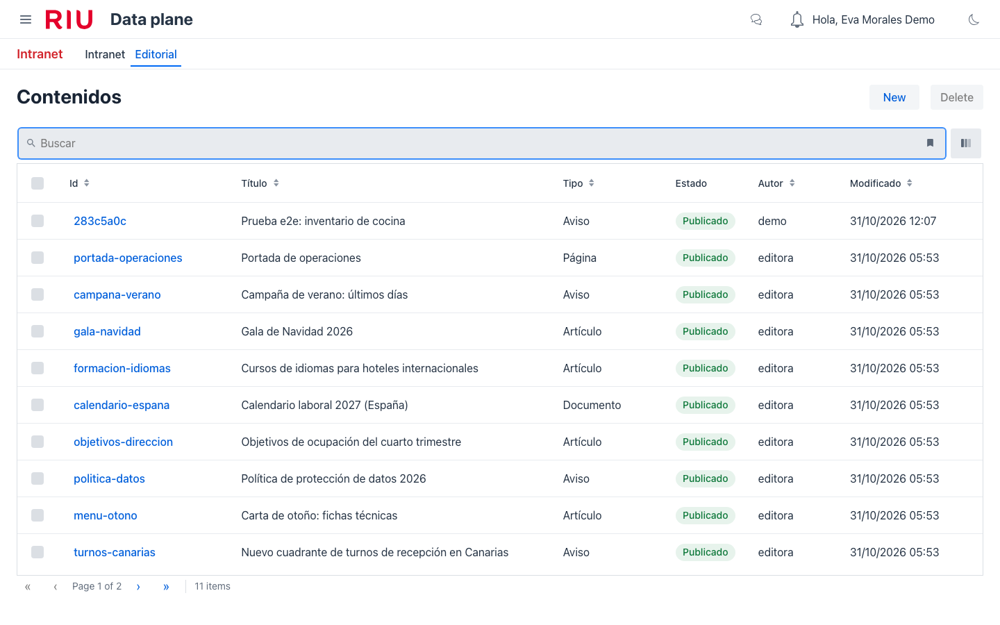

*Contenidos: todos los items, con su tipo, estado, autor y fecha. «New» crea uno.*

### Ciclo de vida de un contenido

**Borrador → En revisión → Publicado → Retirado**. Desde «En revisión» se puede devolver a borrador. La editora envía a revisión; el publicador publica y retira. Editar un item publicado crea un borrador que no afecta a lo que ven los lectores hasta que se publica de nuevo. *Programado* y *caducado* no son estados: salen de las fechas de publicación y caducidad.

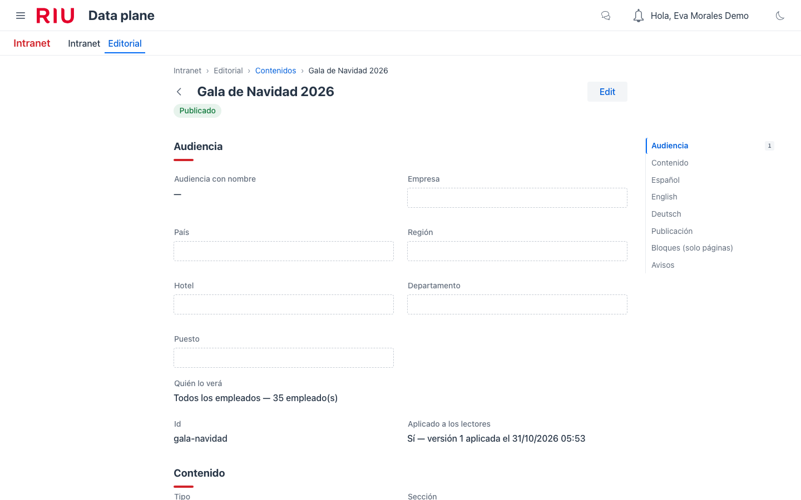

*La ficha de un item: audiencia (con nombre o por atributos, y «Quién lo verá» con el número de empleados), contenido, traducciones (es, en, de), publicación, bloques y avisos.*

  

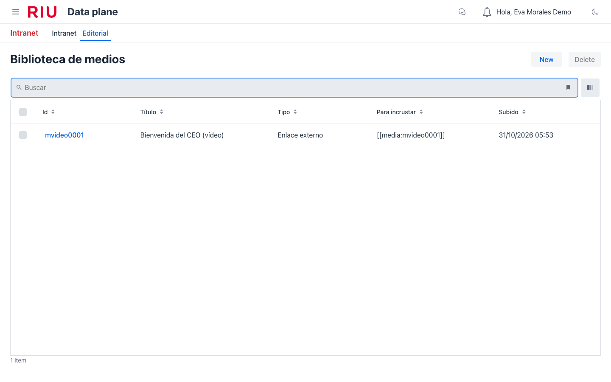

*Medios: ficheros pequeños subidos (imágenes, PDF, audio, vídeo) o externos (YouTube, Vimeo, Drive…), incrustables en los contenidos.*

  

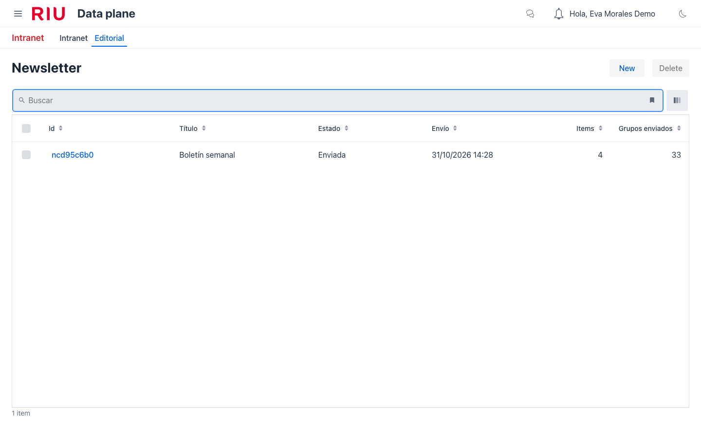

*Newsletter: ediciones con sus items; un envío por grupo de perfil e idioma. En la demo todo va a un buzón de redirección.*

### Ver como

Elige un empleado, un perfil del directorio o una audiencia con nombre y pulsa **Ver la intranet así**: la intranet se muestra con ese perfil (una banda amarilla lo recuerda) hasta pulsar **Salir de ver como**.

  

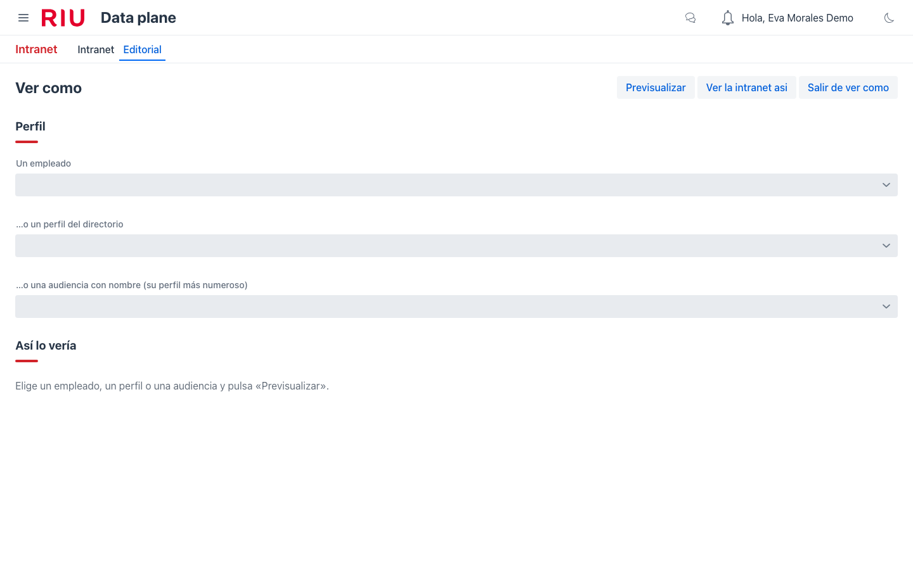

*Ver como: elegir el perfil.*

  

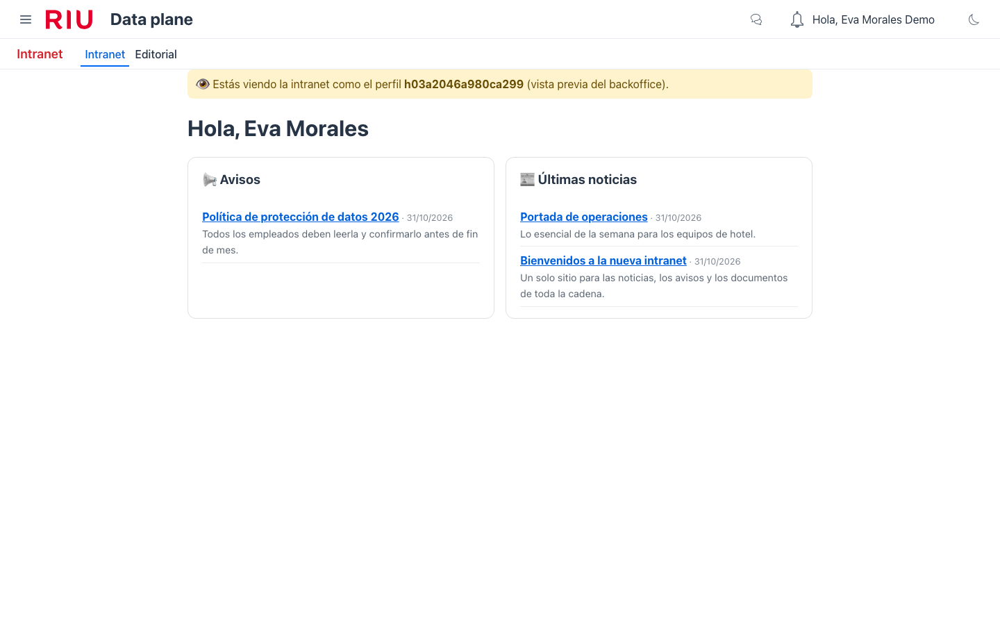

*La intranet vista con el perfil de Klaus Schmidt.*

  

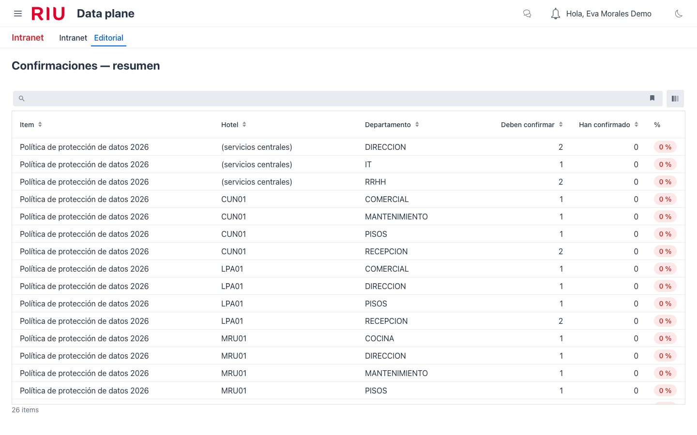

*Confirmaciones: resumen por item de quién ha confirmado.*

  

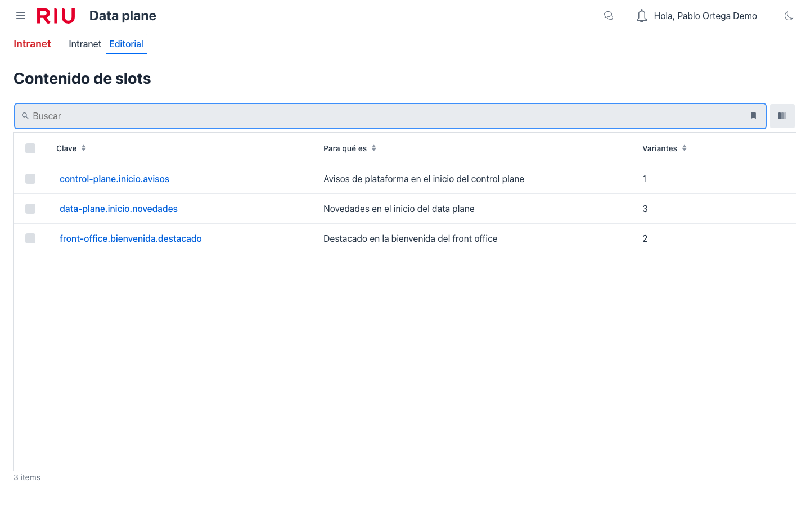

*Contenido de slots (solo publicador): las variantes de cada hueco, con audiencia y prioridad.*

## 6. Configuración (consola de control)

En `http://console.localhost:8800`, menú **Intranet**, con un usuario `ai-admin` y `content:admin` (en la demo, `demo`).

| Pantalla | Para qué |
|---|---|
| Secciones | El árbol de navegación (La empresa › Noticias, Personas › RRHH y nóminas / Formación, Operaciones › Recepción / Cocina, Dirección), con nombres traducidos. |
| Audiencias | Audiencias con nombre reutilizables: Recepción Canarias, Dirección de hotel, Hoteles de España, Equipos de cocina. Redefinir una afecta a todo lo que la usa. |
| Slots | Los huecos de contenido que declaran otras aplicaciones (clave, descripción, texto de reserva). |
| Directorio | La proyección local de empleados y sus atributos. |
| Visibilidad | Estado de la proyección (empleados, perfiles materializados, sujetos con audiencia, caché); «Recalcular» y «Pedir copia del directorio». |

  

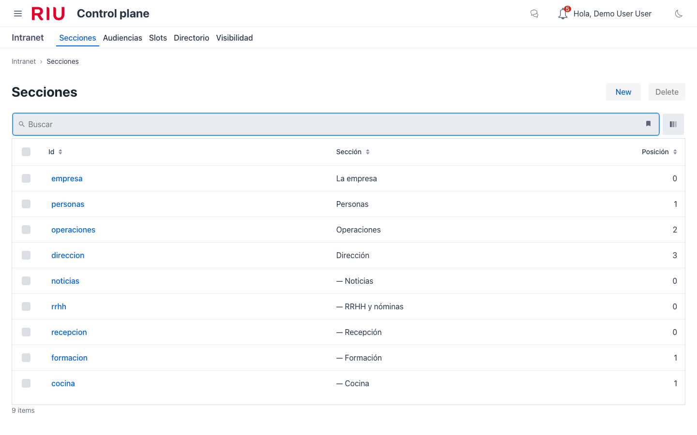

*Secciones.*

  

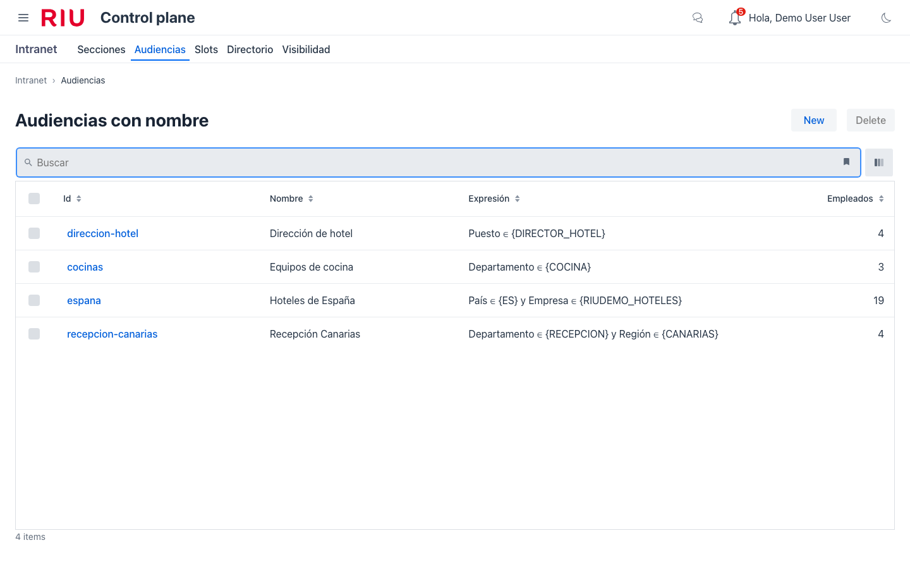

*Audiencias con nombre.*

  

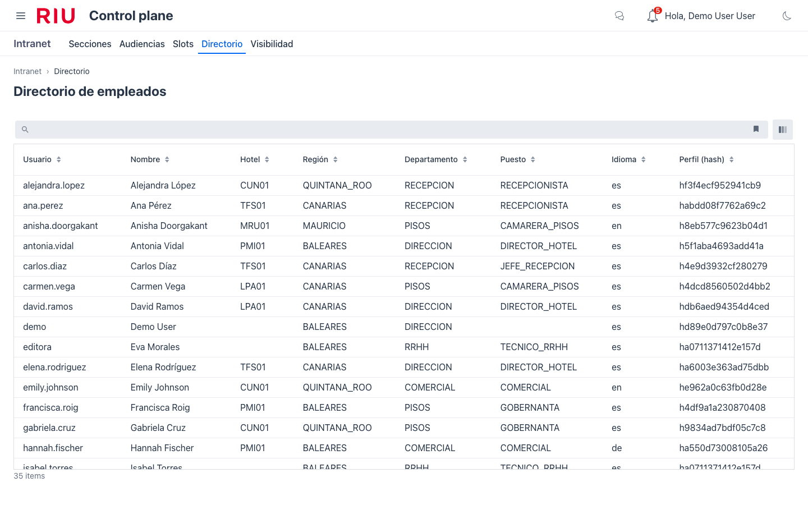

*Directorio de empleados.*

  

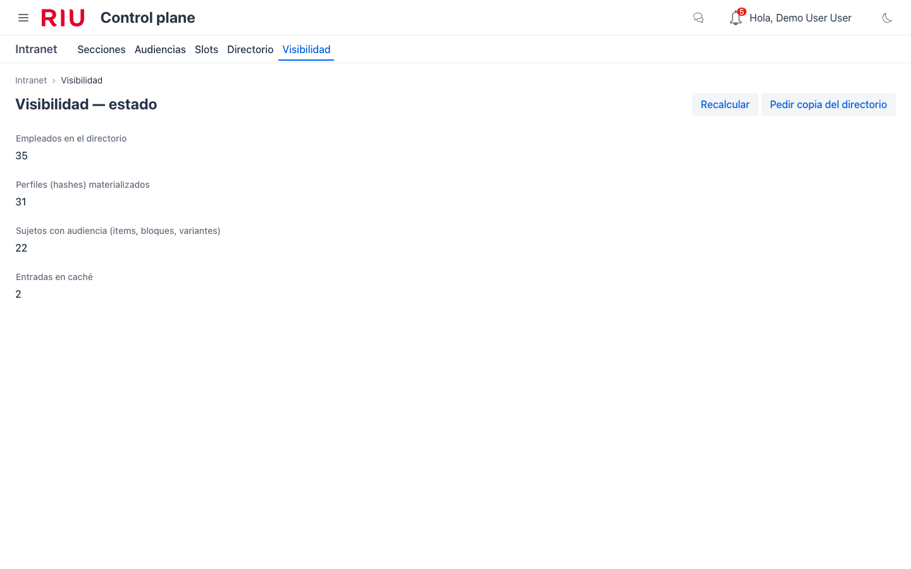

*Visibilidad — estado.*

## 7. Slots: la intranet dentro de otras aplicaciones

Un **slot** es un hueco con clave estable (`aplicacion.pantalla.nombre`) que otra aplicación reserva y content-hub rellena con la variante visible de mayor prioridad para el usuario (o el texto de reserva si no hay ninguna). La demo tiene dos:

| Clave | Dónde | Variantes |
|---|---|---|
| `data-plane.inicio.novedades` | Inicio del plano de datos, tarjeta «Novedades» | General (todos) y Canarias |
| `front-office.bienvenida.destacado` | Bienvenida del front office, tarjeta «Destacado» | General (todos) y Canarias |

  

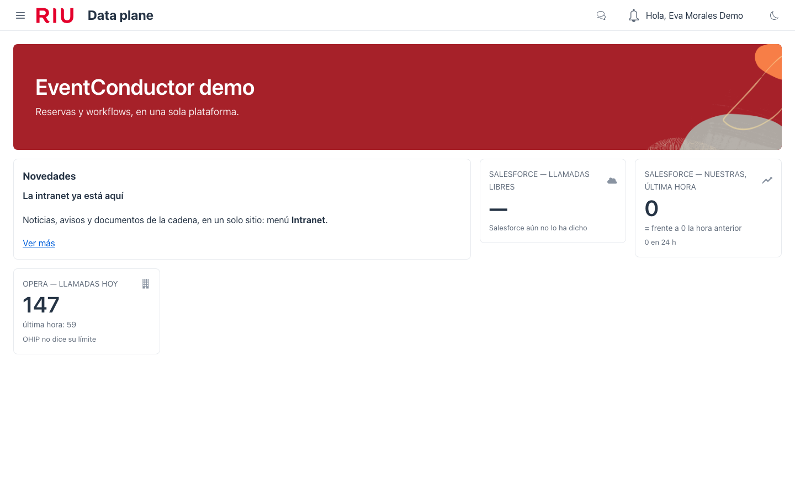

*Plano de datos: la tarjeta «Novedades» es el slot.*

  

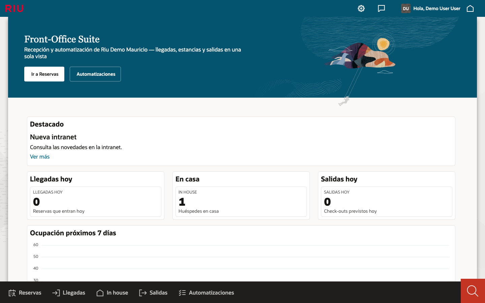

*Front office: la tarjeta «Destacado» es el slot.*

Mientras Mateu no resuelva microfrontends en servidor, el slot se sirve por REST: `GET /_intranet/api/slots/{clave}` con el token del usuario (204 si no hay variante visible).

## 8. El asistente (MCP)

content-hub publica un servidor MCP, registrado como `intranet` en el plano de control de IA para **console-agent** y **reception-agent**. Sus herramientas trabajan con el token del usuario, así que el asistente solo ve lo que el usuario ve:

- `preguntar_intranet` — búsqueda semántica (RAG, pgvector) para responder citando items;
- `buscar_contenido` — búsqueda de texto;
- `leer_item` — el texto completo de un item visible;
- y los pendientes de confirmar del usuario.

Para probarlo: abre el chat del plano de datos y pregunta, por ejemplo, «¿qué dice la política de protección de datos?» o «¿tengo algo pendiente de confirmar?».

## 9. Guion de prueba paso a paso

1. **Visibilidad.** Entra en `http://intranet.localhost:8800` como `ana.perez`: en Avisos está el cuadrante de turnos de Canarias. Sal (o usa otra ventana privada) y entra como `klaus.schmidt`: no está.
2. **Programado y caducado.** Con cualquier usuario, busca «Gala» y «Campaña de verano»: no aparecen, aunque en Editorial › Contenidos ambos están publicados.
3. **Confirmación.** Como `ana.perez`, abre Pendientes › Política de protección de datos 2026 y pulsa **Confirmar lectura**: desaparece de Pendientes y del aviso del Inicio. Como `editora`, Editorial › Confirmaciones refleja la confirmación.
4. **Favoritos.** Marca un artículo con **Favorito** y míralo en Mis favoritos.
5. **Flujo editorial.** Como `editora`, Editorial › Contenidos › New: crea un aviso con audiencia *Equipos de cocina* y envíalo a revisión (no puede publicar). Como `publicador`, ábrelo y publícalo. Compruébalo con «Ver como» un chef (por ejemplo, Jonas Weber) y con un recepcionista.
6. **Slots.** Como `publicador`, Editorial › Contenido de slots: cambia el texto de la variante general de `front-office.bienvenida.destacado` y publícala; recarga el front office como `demo`.
7. **Configuración.** Como `demo`, consola › Intranet › Audiencias: redefine *Recepción Canarias* para incluir también la región de Klaus, mira en Visibilidad que se recalcula, y comprueba con «Ver como» Klaus Schmidt que ahora ve el aviso de turnos. Deshaz el cambio al terminar.
8. **Directorio en vivo.** En la consola de usuarios cambia el departamento de un empleado: lo que ve cambia en segundos, al llegar el evento al directorio.

## 10. Problemas conocidos y soluciones

| Síntoma | Causa | Qué hacer |
|---|---|---|
| «Invalid username or password» con un empleado de la semilla (p. ej. `elena.rodriguez`) | Los empleados sembrados no tienen contraseña en Keycloak, y su perfil exige apellido («Account is not fully set up»). | Ponles contraseña y apellido en Keycloak (`http://auth.localhost:8800`, realm `ec-demo1`, o por la API de administración). Los de la tabla del apartado 2 ya los tienen. |
| Un cambio no se ve en el portal | La visibilidad se recalcula por eventos (segundos); la caché es por perfil. | Espera unos segundos o pulsa Recalcular en Visibilidad. |
| Quiero dejarlo todo como al principio | — | La integración en el reset de la demo (`supporting/demo-reset`) está pendiente; hoy, borrar la base `content_hub` y reiniciar content-hub vuelve a sembrarla. |
